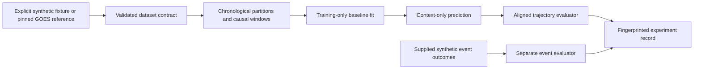

# Proposed Phase P1: reproducible experiment and evaluation foundation

Date: 2026-10-03 (Asia/Kolkata). **PROPOSAL — NOT IMPLEMENTED — AWAITING USER
CHECKPOINT APPROVAL.** Starting main:
`1a4991da4dda9676caeb1d7e35a03408528c3188`.
Milestone branch: `research/experiment-evaluation-foundation`.

## Purpose and boundary

Build a small, UI-independent foundation that lets different forecasters consume
the same causal contexts, predict the same future targets, and produce auditable
development results. The immediate acceptance evidence is deterministic synthetic
testing and, optionally, an existing pinned GOES reference smoke. It is not a
SoLEXS dataset, a JEPA implementation, or a scientific model comparison.

The [repository audit](P1_REPOSITORY_AUDIT.md) verifies the current source and
artifacts. The [Paperclip reconnaissance](P1_LITERATURE_RECONNAISSANCE.md)
supports separate continuous/event contracts, strong cheap comparators,
chronological support isolation, and a conditional-variance role for GARCH.
These documents distinguish evidence from the proposed choices below.

**Phase E remains BLOCKED_FOR_PHASE_E.** P1 accepts only explicitly generated
synthetic data or the already verified GOES reference adapter. Native SoLEXS
columns cannot enter its forecasting runner. A future SoLEXS adapter requires a
separately approved scientific contract and validated dataset; adding a flag or
relabeling native numbers is insufficient. No new scientific acquisition,
calibration, instrument alignment, neural training, or frontend is in scope.

## Approach considered

| Approach | Benefit | Cost / limitation |
|---|---|---|
| **Recommended: NumPy-based contract, cheap baselines, evaluators, and a small runner** | Exercises causality, identity, metrics, and reproducibility now; reuses existing data code without a modelling dependency. | Does not establish neural or SoLEXS forecasting skill. |
| Metrics and persistence only | Smallest code surface. | Leaves configuration, window support, fitted-model leakage, and provenance untested. |
| Full statistical/neural benchmark now | Broader comparison framework. | Requires unapproved model/data decisions and expands beyond this checkpoint; unsuitable while the instrument gate is unresolved. |

The recommended scope includes the minimum fitted linear comparators needed to
test train-only fitting. It does not implement the full older experiment matrix.
Existing experiment/model proposal configs remain proposals and are preserved.

## 1. Forecasting contract

Use ordinary dataclasses, NumPy arrays, and existing pandas time handling. A
dataset defines its role, scientific representation, feature/target names,
units, explicit temporal convention, quality policy, source identities, and
immutable sample coordinates. No instrument semantics are inferred from column
names. Initial windowing supports a declared regular cadence; irregular or
ambiguous grids fail rather than being silently resampled.

A `ForecastSpec` declares cadence, positive integer context/horizon lengths,
origin stride, ordered features/targets, transform, and eligibility policy.
Durations must divide the cadence exactly. Units and reference scales are part
of the spec. Keep the existing 6-hour / 1-hour / 10-minute proposal available
as a reference configuration choice, not as an approved final SoLEXS task.
The synthetic tests also exercise other lengths and multiple targets.

- `ForecastContext`: values/mask `[N, L, C]`, context measurement interval
  starts/ends, optional actual availability times, ordered origin IDs/issue
  times, feature identity, and dataset/spec fingerprints.
- `ForecastTargets`: values/mask `[N, H, K]`, explicit future interval starts/ends,
  target identity/units, origin IDs, and fingerprints.
- `ForecastPrediction`: finite point values `[N, H, K]`, matching coordinates,
  target/transform metadata, model identity, and optional labelled quantiles
  `[N, H, K, Q]`. Quantile levels must be ordered and in `(0,1)`; crossing is
  rejected or reported explicitly, never silently repaired.

`TrainingSlice` contains training windows, unique unwindowed training
observations/targets, and their split identity. `fit(training_slice)` receives
only this partition; this lets the mean and AR baselines use raw training
observations without weighting overlapping windows multiple times.
`predict(contexts, future_grid)` has no argument carrying realized future
targets. Evaluation joins by identifiers and checks times, target order, units,
and fingerprints; equal shapes alone do not establish alignment. Native-space
points and inverse-transformed points are labelled accurately; exponentiating a
log prediction does not warrant calling it a physical-space conditional mean.

For an interval ending at issue time `t`, observations can enter only after that
interval is complete. Future targets cover `[t,t+Δ)`, `[t+Δ,t+2Δ)`, etc.; their
end coordinates are strictly greater than `t`. This distinction prevents an
off-by-one use of the first target bin as input.

Synthetic fixtures explicitly define availability. GOES science products supply
bin end as an **earliest availability bound**, with operational latency unknown.
The GOES smoke is therefore `retrospective_bin_end`, with actual availability
left unknown; operational mode must reject unknown availability. Do not present
the bin-end convention as a measured operational delivery time.

## 2. Windows, chronological splits, and leakage

Partition the raw time axis first, then construct windows. Accept explicit
ordered train/validation/test boundaries and an optional later calibration
partition before test. Reject random-window split modes. Fractions may help
generate a proposal, but executed configs must contain resolved boundaries.
No final SoLEXS dates or fractions are frozen by this design.

Each origin records its entire dependency support: context plus additional
causal feature lookback, future target intervals, and any supplied label-maturity
support. Keep an origin only when that full support is inside its partition.
Use a common maximum context/horizon support for matched model comparisons.
Around a cut at `b`, pure context/horizon support excludes origins spanning
approximately `[b-Hmax, b+Lmax)`; extra lookback/maturity can enlarge it.
Test the exact interval endpoints instead of hard-coding an 18-hour buffer.

The first reference smoke requires complete valid selected-channel context and
targets, with no interpolation. This is a declared smoke eligibility rule, not
an inferred SoLEXS quality rule. The general masked contract and evaluator
support explicit missing targets, report valid counts, and never replace missing
observations with quiet-Sun values. The audited GOES XRS-B sample has 4,318 valid
rows; XRS-A has only 2,267. Consequently the initial reference smoke should be
XRS-B-only, while synthetic fixtures exercise multivariate shapes.

Fit means, AR/ridge coefficients, any learned transforms, and tuning decisions
on training/development data only. Keep parameters frozen for validation/test
predictions; a past context can advance the forecast state without becoming a
new parameter-fitting sample. P1 implements no adaptive refit regime. Future
self-supervised pretraining must use training-period target support only.
Probability/interval calibration uses a separate declared partition if added.

No centered smoothing, future joins, backward fill, future peak normalization,
or full-series scaler fitting is allowed. Existing backward derivatives may be
reused only with their complete dependency support recorded. Persist actual
retained/excluded origin IDs and exclusion reasons, not just split ratios.

Event-group purging accepts externally supplied, defined group intervals and
maturity times. P1 tests this with synthetic groups that cross boundaries.
It neither derives real GOES onset labels nor guesses SoLEXS event semantics.
Real grouping requires approved onset/ongoing-event, recovery, coverage, and
maturity rules. Overlapping forecast origins are not independent replicates;
preserve their losses for a later approved paired block-uncertainty analysis.

## 3. Baselines and statistical scope

All six initial point comparators share `fit`/`predict` and the same eligible
origins. Baselines lacking fitted parameters still record the supplied spec.
The initial persistence/drift/AR comparators require an observed context
counterpart for each target; incompatible feature/target mappings fail clearly.

| Baseline | Proposed definition and verification |
|---|---|
| Persistence | Repeat the latest eligible observed target value across the future grid; never carry an unavailable sample into a context. |
| Training-period mean | Constant per-target mean from valid unique training observations; do not overweight samples merely because windows overlap. |
| Trailing mean | Fixed context-only lookback, with its length explicit; no centered mean or future fill. |
| Drift | Extrapolate the slope between the first and last valid points of its declared context support using elapsed time; reject insufficient support. |
| Small AR | Fixed AR(1) with intercept for the initial fixture runner, fitted to adjacent valid training pairs and recursively forecast; never bridge gaps. Larger lag selection is deferred. |
| Direct ridge | Regularized linear map from the declared past lag vector to the full future target vector; fixed lag length and regularization in the initial runner. |

Use NumPy linear algebra; no new fitting dependency is necessary for this scope.
Transforms are explicit and shared for comparison. A log transform requires
positive valid values and a declared dimensional reference; inversion and
overflow handling are tested. Native-scale drift can violate a target's domain;
record violations and failures without clipping or discarding origins to improve
scores. Synthetic fixture cases verify its mathematical behaviour. A later
GOES smoke may declare a log-space baseline track, with the output's transform
and point interpretation recorded.

**ARCH/GARCH recommendation:** conditional-variance/secondary comparisons only.
P1 records `deferred_pending_residual_diagnostics`, reserves probabilistic output
metadata, and documents the intended same-mean constant-variance control. It
implements no volatility fit. A later approval must specify training-only
residual diagnostics, distribution, adequacy/convergence rules, and variance
versus decoded-trajectory scoring. ARIMA, fractional models, neural/SSL controls,
and baseline uncertainty fitting likewise remain outside the first foundation.

## 4. Evaluation

Trajectory evaluation returns MAE/RMSE by target and lead, valid counts,
declared aggregate weights, matched-origin persistence-relative skill, and MASE
using valid adjacent *unique training observations* for its denominator.
Diagnostic Pearson correlation requires at least two pairs and nonzero variance.
Zero persistence loss, zero MASE scale, empty masks, and constant correlation
inputs return explicit NA plus a reason. Accumulate squared errors before taking
aggregate RMSE; do not average per-window RMSE and call it pooled RMSE.

Targets determine the scoring mask shared by all methods. Nonfinite predictions
on valid target cells are model failures; they do not become model-specific
exclusions. Include per-origin errors, origin identities, and coverage so later
paired comparisons cannot silently use different observations. Physical-unit
and log-space errors have separate names/units. No raw aggregate mixes
incommensurate target units. Quantile pinball loss is supported only for actual
declared quantiles; point predictions are not fabricated quantile distributions.

An independent event evaluator takes supplied binary outcomes, valid/mature
label masks, decisions or probabilities, a declared horizon/event definition,
and origin IDs. Return TP/FP/FN/TN, precision, recall/POD, FAR, F1, TSS, HSS2,
and Brier score when probabilities are present. FAR is `FP/(TP+FP)`; FPR is
`FP/(FP+TN)`. Use hand-verified formulas and NA reasons. P1 evaluates these on
synthetic supplied labels only. Event-level alarm matching, lead-time scoring,
PR curves, operational risk calibration, and real event-label construction are
deferred. The prior proposed mean-pinball scientific primary endpoint is not
replaced by this mechanics-focused point evaluator.

## 5. Configuration, identities, and result recording

Resolved configuration has a schema version, explicit dataset role/mode,
features/targets/units, temporal/quality/transform policies, split boundaries,
baseline parameters, metric reductions, and seeds. Reject duplicate/unknown
fields, nonfinite JSON, and unsupported scientific input modes. Preserve the
older blocked SoLEXS configs; add separate synthetic/reference smoke configs.

Fingerprint canonical finite JSON with SHA-256. Dataset identity includes
source/manifest hashes, adapter and semantic policies, feature/target schema,
and logical sample/mask/time content. Split identity includes actual ordered
origin IDs, boundaries, support rules, and exclusions. Config identity includes
the resolved scientific and execution choices. Paths are repository-relative or
explicitly configured; host names and execution timestamps are not semantic
dataset identity. A changed sample, mask, unit, split, or policy changes identity.

Record Git commit/branch, tracked-dirty state, source-file hashes, package
versions, Python/platform information, installed-versus-checkout code identity,
and per-model seeds. The initial reproducible runner requires clean tracked
source; the preserved unrelated Paperclip pointer is recorded as an untracked
configuration path and does not become a model/data input. Collect no credentials
or full environment-variable dump. Use Python/NumPy seed handling and local RNG
objects with separately named fixture/model streams; retain [17,29,43] as existing
proposed repeat seeds without claiming that deterministic baselines need neural
seed averaging. Bitwise portability across numerical libraries is not assumed.

An experiment identity combines config/dataset/split/source fingerprints and
seed. A separate execution ID distinguishes reruns and wall-clock metadata.
Write resolved config, dataset/split manifests, environment/provenance, model
parameters, per-origin predictions/errors, metrics/counts, exclusions, failures,
and artifact hashes under ignored `results/experiments/`. Publish atomically,
refuse unsafe output paths/accidental replacement, and record failed runs rather
than dropping them. Keep reusable result schema outside ignored `results/`.
Synthetic/reference outputs explicitly say `foundation_smoke_not_scientific_skill`.

## 6. Proposed files and reuse

These paths are a design inventory; none has been scaffolded or implemented.

```text
src/solar_flare_jepa/
  forecasting/
    contracts.py      # dataset/context/target/prediction/spec validation
    windows.py        # regular causal windows and support/exclusion records
    splitting.py      # chronological partitions and supplied-group purging
    baselines.py      # the six cheap point comparators
  evaluation/
    trajectory.py     # aligned point/quantile metrics and training scales
    events.py         # supplied-label decision/probability metrics
  experiments/
    config.py         # strict resolved config and canonical fingerprints
    provenance.py     # dataset/split/code/environment/artifact identities
    fixtures.py       # deterministic artificial multivariate series
    runner.py         # bounded synthetic / pinned GOES reference runs
scripts/run_experiment.py
configs/experiments/p1_synthetic.json
configs/experiments/p1_goes_reference.json
schemas/experiment_result.schema.json
tests/test_forecasting_contract.py
tests/test_forecasting_windows.py
tests/test_forecasting_splits.py
tests/test_baselines.py
tests/test_trajectory_metrics.py
tests/test_event_metrics.py
tests/test_experiment_provenance.py
tests/test_experiment_runner.py
```

Add ordinary package initializers where required. Reuse
`data.goes.read_goes`, pinned-path verification/SHA-256 utilities, and path
containment rules. Read the existing GOES preparation sidecar rather than
reimplementing calibration/time handling. `results/schema.json` is an ignored
six-file metadata inventory, not a reusable experiment schema. Preserve
`data.solexs`, source archives, C/D/D.1 manifests, and historical reports.



## 7. Meaningful tests and acceptance evidence

- Contract tests: mismatched origins/times/order/units, context-target overlap,
  unknown availability in operational mode, nonfinite valid predictions,
  masks, multivariate shapes, transforms, and quantile ordering.
- Window/split tests: half-open endpoints, future perturbation leaves earlier
  contexts unchanged, derivative lookback, full-support containment, no shared
  observation/target support across partitions, supplied event straddling and
  maturity, gaps, and informative empty/insufficient partitions.
- Baseline tests: known constant/ramp/AR forecasts, train-mean weighting over
  unique observations, gap handling, exact ridge toy recovery, and changing
  validation/test values cannot change fitted parameters.
- Metric tests: hand-computed MAE/pooled RMSE/MASE/persistence skill/pinball,
  correlation degeneracy, common masks, failed predictions, and complete binary
  confusion tables including FAR versus FPR and undefined denominators.
- Provenance/runner tests: canonical config ordering, changes to data/masks/
  policy/splits/code change identity, reproducible fixture/prediction identities,
  relocation, failure recording, safe atomic publication, and installed CLI
  use without `PYTHONPATH`. Raw scientific data are not test fixtures.
- After approved source work: full existing/new pytest suite, normal imports
  and CLI smoke after reinstalling the package, deterministic synthetic rerun,
  and an opt-in existing-GOES smoke with verified source hashes. No download or
  training. Local real-data absence must not break ordinary CI tests.

Acceptance requires code and recorded checks, not the presence of these proposed
files. Final review checks source scope, unchanged protected data/manifests,
actual ignore rules, index/history, `git diff --check`, status, and feature-branch
upstream. Confidence intervals, baseline adequacy, final task selection, and
scientific superiority remain untested by this foundation.

## Requested checkpoint decision

Approve or revise this proposed P1 scope before any scaffolding, dependency
change, product code, baseline fit, experiment run, or major implementation.
Approval of P1 does not unblock Phase E or authorize a merge/push to main,
SoLEXS interpretation/calibration/alignment/acquisition, or SolarJEPA training.
