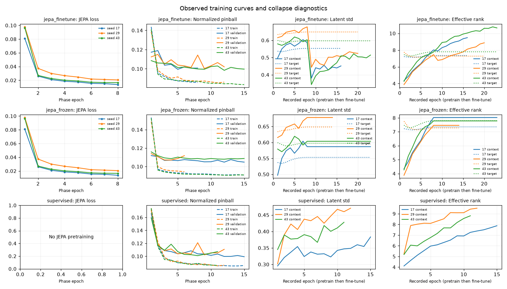
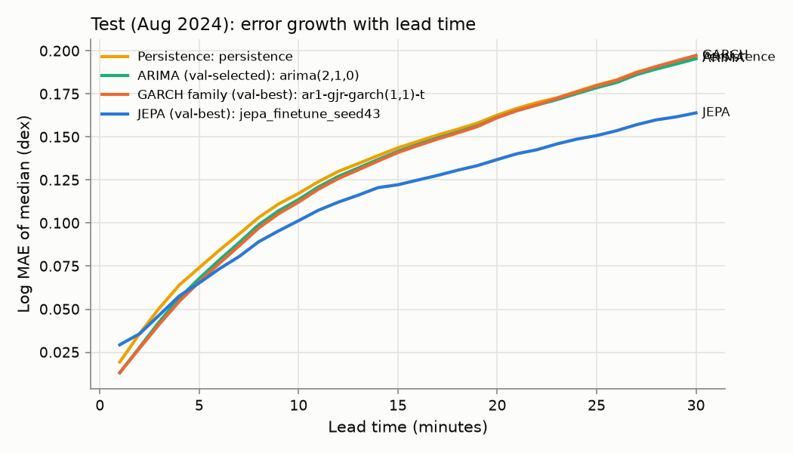
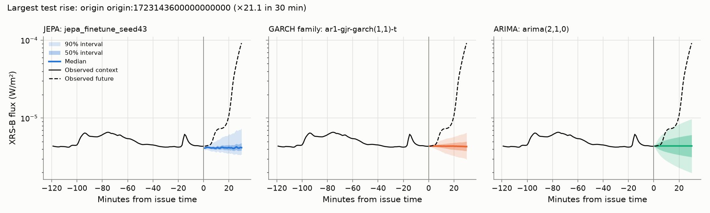
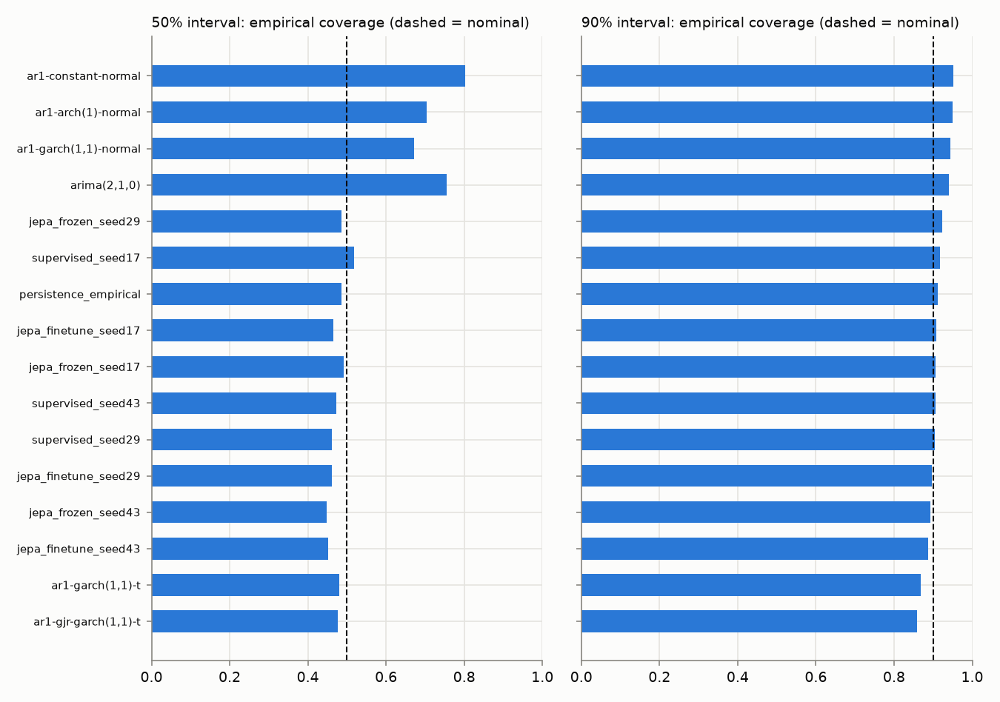

# SolarJEPA V1 comparison results

**OBSERVED:** The strict V1 workflow completed on 2026-10-09 with 25 validation candidates, 22 test models, all nine neural runs and no recorded model exceptions. All nine saved neural checkpoints reproduced every saved test quantile and point forecast bit for bit after reload.

**INFERRED:** Fine-tuned JEPA beats the supervised control on the mean loss over these three fitted seeds: mean pinball 0.0392450927 versus 0.0395002178 dex (about 0.646% lower), difference −0.000255125056 dex, conditional daily-block 95% CI [−0.000551146471, −0.0000223073697]. This is a small, seed-sensitive advantage: seeds 17 and 29 have slightly higher losses than their matching controls with CIs containing zero; seed 43 has lower loss with a CI below zero. The CI holds the fitted seeds fixed and does not establish a stable advantage over the population of training runs. Frozen JEPA is worse than the control: +0.00192979747 dex, CI [0.00138527571, 0.00254837365].

**INFERRED:** Against validation-selected GJR-GARCH(1,1)-t, fine-tuned JEPA improves mean pinball by −0.00534674678 dex, CI [−0.00644247417, −0.00431306552]; frozen JEPA improves it by −0.00316182426 dex, CI [−0.00433450316, −0.00201178469]. These are comparisons of finite-horizon forecasts under the fitted implementations, with the optimizer and near-unit-persistence qualifications below.

**OBSERVED:** Source run `v1-full-20261009`, mode STRICT/full, source commit `4a3f88227ce28dea0e885e68987282285963f38e`, branch `v1`; run UTC 2026-10-09T15:21:39.239319+00:00 → 2026-10-09T15:40:05.836667+00:00.

## Outcome and conditional uncertainty

- **INFERRED:** `jepa_finetune mean losses seeds=[17, 29, 43]` versus `supervised mean losses seeds=[17, 29, 43]`: lower loss; the conditional 95% interval excludes zero in its favour. Difference -0.000255125056 dex, 95% CI [-0.000551146471, -2.23073697e-05].
- **INFERRED:** `jepa_finetune mean losses seeds=[17, 29, 43]` versus `persistence_empirical`: lower loss; the conditional 95% interval excludes zero in its favour. Difference -0.00660807221 dex, 95% CI [-0.0077844777, -0.0054998836].
- **INFERRED:** `jepa_finetune mean losses seeds=[17, 29, 43]` versus `ar1-gjr-garch(1,1)-t`: lower loss; the conditional 95% interval excludes zero in its favour. Difference -0.00534674678 dex, 95% CI [-0.00644247417, -0.00431306552].
- **INFERRED:** `jepa_finetune mean losses seeds=[17, 29, 43]` versus `arima(2,1,0)`: lower loss; the conditional 95% interval excludes zero in its favour. Difference -0.00833732181 dex, 95% CI [-0.00932444346, -0.00735857818].
- **INFERRED:** `jepa_frozen mean losses seeds=[17, 29, 43]` versus `supervised mean losses seeds=[17, 29, 43]`: higher loss; the conditional 95% interval excludes zero in the reference's favour. Difference 0.00192979747 dex, 95% CI [0.00138527571, 0.00254837365].
- **INFERRED:** `jepa_frozen mean losses seeds=[17, 29, 43]` versus `persistence_empirical`: lower loss; the conditional 95% interval excludes zero in its favour. Difference -0.00442314969 dex, 95% CI [-0.00557152039, -0.00332091951].
- **INFERRED:** `jepa_frozen mean losses seeds=[17, 29, 43]` versus `ar1-gjr-garch(1,1)-t`: lower loss; the conditional 95% interval excludes zero in its favour. Difference -0.00316182426 dex, 95% CI [-0.00433450316, -0.00201178469].
- **INFERRED:** `jepa_frozen mean losses seeds=[17, 29, 43]` versus `arima(2,1,0)`: lower loss; the conditional 95% interval excludes zero in its favour. Difference -0.00615239929 dex, 95% CI [-0.00715231876, -0.00507265879].

**DOCUMENTED:** [V1_PLAN.md](V1_PLAN.md) and [V1_RUN.md](V1_RUN.md) define a bounded GOES-16 May–August 2024 comparison. Models fit training only; ARIMA order uses validation dex mean pinball. **OBSERVED:** JEPA uses validation pinball in train-standardized transformed units to select each seed's checkpoint. This weights channels by inverse training standard deviation, unlike equal-channel dex scoring. Final reported pinball and MAE are in dex. The supervised model has the same architecture without JEPA pretraining.

**INFERRED:** Supplementary family contrasts average each seed's per-origin loss, then bootstrap that mean loss. They are not scores of an ensemble of averaged predictions. JEPA/control contrasts use matching available seeds; classical-reference contrasts use all available seeds for that JEPA variant. CIs condition on these fitted seeds and do not capture full training or model-selection uncertainty. Both JEPA variants are shown; no variant is chosen on test.

## Execution and verification

**OBSERVED:** Reused the existing repository, fetched all remotes and created local `v1` tracking `origin/v1` at `0f345ce0b960063cb644176a08b7bda0105aab71`. Read `AGENTS.md`, `V1_PLAN.md`, then `V1_RUN.md`. Initial untracked `.agents/` and `docs/P1_FINAL_INTEGRATION_REAUDIT.md` were retained and their SHA-256 identities remained unchanged. The tracked tree was clean for the strict run; its existing untracked paths were admitted by the unchanged provenance policy.

**OBSERVED:** Installed exactly `requirements-v1-lock.txt` with Python 3.13 and a normal `.venv/bin/python -m pip install --no-deps .` installation. `pip check` passed. The reused environment initially blocked pytest startup while macOS reported installed metadata as `dataless`; that attempt was interrupted without a test result. The original environment is preserved in ignored `.cache/v1-preexisting-venv-20261009`; a fresh `.venv` installed the same locked packages successfully. Versions include Torch 2.6.0, statsmodels 0.14.5, arch 7.2.0, SciPy 1.18.1 and patsy 1.0.3. No package pins were changed.

**OBSERVED:** Ran acquisition followed by `--verify` for `p2_goes_july2024.json`, `v1_goes_202405.json`, `v1_goes_202406.json` and `v1_goes_202408.json`. All 123 daily file identities passed: May 31, June 30, July 31, August 31 (36,535,474 bytes total). July was already local; 92 missing files were downloaded through the existing bounded pipeline and checked against the pinned manifest identities. All four tracked manifests remained unchanged. Raw products remain ignored and were not committed.

| Check | Actual result |
|---|---|
| Original three V1 test modules | 86 passed (87.38 s) |
| Original full `.venv/bin/python -m pytest -q` | 1,170 passed, 1 warning (94.93 s) |
| New provenance regression before fix | 1 expected failure: missing `git_commit` (2.49 s) |
| Three V1 modules plus `tests/test_v1_runner.py` after fix | 87 passed (11.27 s) |
| First post-fix full suite before reinstall | 1 failed, 1,170 passed (84.08 s): `test_installed_synthetic_run_does_not_require_optional_aditya_imports` rejected stale installed V1 source |
| Affected installed-package test plus provenance regression after normal reinstall | 2 passed (2.55 s) |
| Final full suite after normal reinstall | 1,171 passed, 1 warning (86.94 s) |
| Prescribed `--dev --quick` integration smoke | Exit 0; 19 validation candidates, 16 test models, all three variants at seed 17, zero model exceptions |
| Prescribed strict comparison, without `--dev` or `--quick` | Exit 0; 25 validation candidates, 22 test models, all three variants × seeds 17/29/43, zero model exceptions |
| Post-run actual-artifact verification | 22 test score records recomputed from NPZ; 86,160 scored cells on 1,436 aligned test origins; all 9 checkpoints reloaded and all test predictions bitwise identical |

**OBSERVED:** The full-suite warning was `RuntimeWarning: numpy.ndarray size changed, may indicate binary incompatibility. Expected 16 from C header, got 96 from PyObject`, reported by `test_adapter_preserves_selected_quality_mask_and_unknown_actual_availability`. It was not suppressed or resolved by changing the pinned environment.

**OBSERVED:** Independent inspection found the V1 serializer used nonexistent `code_provenance()['git']`, losing the actual SHA, branch and runtime. Commit `4a3f88227ce28dea0e885e68987282285963f38e` preserves the full existing provenance object and fixes the report lookup; its integration regression demonstrated failure before the fix and passed afterward. Scientific processing, models, fitting, checkpoint selection and both benchmark configurations were unchanged. A read-only code review found no blocking issue.

**OBSERVED:** A strict preflight and the first post-run source check each refused a metadata change during hashing of `src/solar_flare_jepa/data/__init__.py`. Fresh retries passed without changing files or weakening the guard. The final executed-source fingerprint and all stored source-file identities matched the checkout and normal installation. **UNKNOWN:** The precise external cause of these metadata changes; no Git content change was observed.

**OBSERVED:** The prescribed smoke scores August before the strict run. Both configurations stayed byte-identical to their pre-execution hashes, and no test result informed a configuration or model-selection change. The runner evaluates fixed baselines before the later model-selection loops; therefore “untouched until all selections were frozen” in its generated heading should be read as “not used for selection,” not a literal statement about evaluation order. The strict report is the source of all scientific numbers in this document.

```bash
.venv/bin/python -m pytest -q tests/test_v1_foundation.py tests/test_statistical.py tests/test_jepa.py
.venv/bin/python -m pytest -q
.venv/bin/python scripts/run_v1_comparison.py --root "$PWD" --output-dir results/experiments/v1-smoke --dev --quick
.venv/bin/python scripts/run_v1_comparison.py --root "$PWD" --output-dir results/experiments/v1-full-20261009
```

**OBSERVED:** Local execution evidence, raw verification JSONs, preserved-path/config hashes, regression logs, the report-derivation helper and actual-artifact replay checker are retained under ignored `results/experiments/v1-execution/`. The strict outputs remain under ignored `results/experiments/v1-full-20261009/`; normal reruns must use a new output directory because existing output replacement is refused.

**OBSERVED (coordinator host inspection):** Mac14,2, 8 GiB RAM, Python 3.13.3; the run guide's Mac M4/16 GB assumption differs. The configured CPU/thread budget is recorded per model below. MPS behavior is UNKNOWN.

### Saved environment

```json
{
  "python": "3.13.3 (v3.13.3:6280bb54784, Apr  8 2025, 10:47:54) [Clang 15.0.0 (clang-1500.3.9.4)]",
  "platform": "macOS-26.3-arm64-arm-64bit-Mach-O",
  "packages": {
    "netCDF4": "1.7.2",
    "numpy": "2.2.6",
    "pandas": "2.3.3",
    "pyarrow": "25.0.1",
    "solar-flare-jepa": "0.1.0",
    "xarray": "2026.7.0"
  },
  "tracked_dirty": false,
  "git_commit": "4a3f88227ce28dea0e885e68987282285963f38e",
  "git_branch": "v1"
}
```

## Protocol and available seed support

| Partition | UTC half-open start | UTC half-open end | Retained origins |
|---|---|---|---|
| train | 2024-05-01T00:00:00+00:00 | 2024-07-22T00:00:00+00:00 | 3609 |
| validation | 2024-07-22T00:00:00+00:00 | 2024-08-01T00:00:00+00:00 | 412 |
| test | 2024-08-01T00:00:00+00:00 | 2024-09-01T00:00:00+00:00 | 1436 |

| Family | Requested seeds | Observed test seeds | Missing seeds |
|---|---|---|---|
| jepa_finetune | [17, 29, 43] | [17, 29, 43] | [] |
| jepa_frozen | [17, 29, 43] | [17, 29, 43] | [] |
| supervised | [17, 29, 43] | [17, 29, 43] | [] |

**OBSERVED:** Dataset fingerprint `d21b81b42643777f68855d8e02fc17cb7fb326805763117f8e5863233d68ba12`. Evaluation uses stride-30 origins; JEPA trains on eligible stride-1 raw-training windows capped at 20,000 by deterministic chronological subsampling. These are different window counts. Eligibility and scored support come from the saved manifests. All model comparisons use retained origin-aligned losses; a model failure is reported rather than repaired by dropping origins.

## Validation tables

**OBSERVED:** JEPA-family cells are arithmetic seed means ± sample standard deviation where multiple seeds exist. The standard deviation is descriptive seed variation, not a confidence interval. Dashes indicate a metric that is not available.

| Model / family | Seeds | Log MAE (dex) | Log MAE skill vs persistence | Mean pinball (dex) | 50% coverage | 50% width (dex) | 90% coverage | 90% width (dex) | Native MAE (W/m²) | Native RMSE (W/m²) |
|---|---|---|---|---|---|---|---|---|---|---|
| ar1 | 1 | 0.153802136 | 0.0334300404 | — | — | — | — | — | 1.12773692e-06 | 5.36475331e-06 |
| ar1-arch(1)-normal | 1 | 0.152732745 | 0.0401506331 | 0.0554539625 | 0.656067961 | 0.310527463 | 0.934021036 | 0.945942516 | 1.08725062e-06 | 5.22147165e-06 |
| ar1-constant-normal | 1 | 0.152813467 | 0.0396433378 | 0.056831156 | 0.763187702 | 0.364047074 | 0.93644822 | 0.887229798 | 1.09305409e-06 | 5.25301076e-06 |
| ar1-garch(1,1)-normal | 1 | 0.152533701 | 0.041401524 | 0.0542696314 | 0.61670712 | 0.284854325 | 0.920873786 | 0.842799405 | 1.08908156e-06 | 5.2475042e-06 |
| ar1-garch(1,1)-t | 1 | 0.15250973 | 0.041552173 | 0.053679839 | 0.429854369 | 0.167519157 | 0.835881877 | 0.526807682 | 1.0914687e-06 | 5.23438691e-06 |
| ar1-gjr-garch(1,1)-t | 1 | 0.150576659 | 0.0537005599 | 0.0535688468 | 0.427872168 | 0.168006858 | 0.820833333 | 0.52238507 | 1.07748999e-06 | 5.21808221e-06 |
| arima(1,1,0) | 1 | 0.152617927 | 0.0408722097 | 0.0568119151 | 0.765088997 | 0.363858829 | 0.935679612 | 0.887329296 | 1.09265213e-06 | 5.24769513e-06 |
| arima(1,1,1) | 1 | 0.154614883 | 0.0283223338 | 0.056028731 | 0.725889968 | 0.324615749 | 0.921925566 | 0.791628622 | 1.12120384e-06 | 5.36825356e-06 |
| arima(2,1,0) | 1 | 0.155490122 | 0.0228218928 | 0.0558933123 | 0.708211974 | 0.309526645 | 0.914927184 | 0.754831373 | 1.13463639e-06 | 5.41740819e-06 |
| arima(2,1,1) | 1 | 0.154826902 | 0.0269899004 | 0.0559801743 | 0.721885113 | 0.320431761 | 0.920631068 | 0.781425283 | 1.12338503e-06 | 5.3769294e-06 |
| direct_ridge | 1 | 0.147977636 | 0.0700341327 | — | — | — | — | — | 9.52629826e-07 | 4.74929307e-06 |
| drift | 1 | 0.216204443 | -0.358737432 | — | — | — | — | — | 5.01986747e-06 | 8.64672796e-05 |
| persistence | 1 | 0.159121577 | 0 | — | — | — | — | — | 1.20756844e-06 | 5.68378646e-06 |
| persistence_empirical | 1 | 0.157553921 | 0.00985194167 | 0.0557616824 | 0.428033981 | 0.155445177 | 0.873260518 | 0.64665926 | 1.17492371e-06 | 5.5982978e-06 |
| trailing_mean | 1 | 0.208865377 | -0.312615048 | — | — | — | — | — | 1.39549453e-06 | 5.18634906e-06 |
| training_mean | 1 | 0.356799501 | -1.24230747 | — | — | — | — | — | 1.77980221e-06 | 5.62963119e-06 |
| jepa_finetune | 3 | 0.136954406 ± 0.00125198677 | 0.139309649 | 0.0471695142 ± 0.000413100953 | 0.46271575 ± 0.0172356842 | 0.160634537 ± 0.0082827184 | 0.877535059 ± 0.01481159 | 0.562527265 ± 0.0426193058 | 8.74550169e-07 ± 1.00878699e-08 | 4.5792178e-06 ± 2.63077502e-08 |
| jepa_frozen | 3 | 0.146422249 ± 0.00177633886 | 0.0798089658 | 0.0504857314 ± 0.000723602849 | 0.455730852 ± 0.0201708105 | 0.168975143 ± 0.00743345539 | 0.87385383 ± 0.0249067557 | 0.581020715 ± 0.0380069968 | 9.23392036e-07 ± 1.78931147e-08 | 4.60441543e-06 ± 1.93094398e-08 |
| supervised | 3 | 0.139656832 ± 0.0014734433 | 0.122326246 | 0.0477632308 ± 0.000533581908 | 0.48425027 ± 0.014825063 | 0.167817798 ± 0.00581671838 | 0.891423948 ± 0.00650867214 | 0.566712337 ± 0.017581135 | 8.83885171e-07 ± 1.46350666e-08 | 4.54659934e-06 ± 2.4779316e-08 |

## Test tables

| Model / family | Seeds | Log MAE (dex) | Log MAE skill vs persistence | Mean pinball (dex) | 50% coverage | 50% width (dex) | 90% coverage | 90% width (dex) | Native MAE (W/m²) | Native RMSE (W/m²) |
|---|---|---|---|---|---|---|---|---|---|---|
| ar1 | 1 | 0.128617438 | 0.0391319154 | — | — | — | — | — | 7.5548023e-07 | 3.68485426e-06 |
| ar1-arch(1)-normal | 1 | 0.132195818 | 0.012398754 | 0.0486105815 | 0.704236305 | 0.307524923 | 0.950371402 | 0.933244965 | 8.16765318e-07 | 3.80759452e-06 |
| ar1-constant-normal | 1 | 0.13236467 | 0.0111373046 | 0.0506524725 | 0.80185701 | 0.364202016 | 0.951833798 | 0.887191905 | 8.14753352e-07 | 3.73425265e-06 |
| ar1-garch(1,1)-normal | 1 | 0.132120408 | 0.0129621263 | 0.0470413292 | 0.670798514 | 0.283637352 | 0.943245125 | 0.836955487 | 8.13583456e-07 | 3.72828363e-06 |
| ar1-garch(1,1)-t | 1 | 0.131996471 | 0.0138880226 | 0.0451494541 | 0.48091922 | 0.165608931 | 0.868303157 | 0.519378238 | 8.18859228e-07 | 3.8554727e-06 |
| ar1-gjr-garch(1,1)-t | 1 | 0.130401695 | 0.0258021922 | 0.0445918395 | 0.47588208 | 0.165299911 | 0.858136026 | 0.511782351 | 7.81359312e-07 | 3.44518677e-06 |
| arima(2,1,0) | 1 | 0.130802634 | 0.0228068751 | 0.0475824145 | 0.755199629 | 0.309526645 | 0.939902507 | 0.754831373 | 7.65947302e-07 | 3.27420991e-06 |
| direct_ridge | 1 | 0.124311806 | 0.0712981985 | — | — | — | — | — | 6.72642113e-07 | 3.3483394e-06 |
| drift | 1 | 0.188146478 | -0.405594357 | — | — | — | — | — | 2.46412055e-06 | 5.08788839e-05 |
| persistence | 1 | 0.133855459 | 0 | — | — | — | — | — | 8.1055501e-07 | 3.83590424e-06 |
| persistence_empirical | 1 | 0.132103713 | 0.0130868502 | 0.0458531649 | 0.485225162 | 0.155445177 | 0.912000929 | 0.64665926 | 7.86340539e-07 | 3.79343494e-06 |
| trailing_mean | 1 | 0.16616143 | -0.241349669 | — | — | — | — | — | 1.08192202e-06 | 4.96861013e-06 |
| training_mean | 1 | 0.246614084 | -0.842390937 | — | — | — | — | — | 1.37385339e-06 | 5.36294058e-06 |
| jepa_finetune | 3 | 0.116593228 ± 0.00199274068 | 0.128961724 | 0.0392450927 ± 0.000791626587 | 0.459172857 ± 0.00708413433 | 0.14512495 ± 0.00541495011 | 0.89719901 ± 0.0107365952 | 0.527205559 ± 0.0424849006 | 6.41232314e-07 ± 1.50420958e-08 | 3.35948851e-06 ± 2.39429608e-08 |
| jepa_frozen | 3 | 0.123758671 ± 0.00369907365 | 0.0754305307 | 0.0414300152 ± 0.00141720198 | 0.475816311 ± 0.0234004194 | 0.162437626 ± 0.00995218546 | 0.907219127 ± 0.0155437404 | 0.568512711 ± 0.0506438244 | 7.24313529e-07 ± 5.2420831e-08 | 3.8795477e-06 ± 3.41467762e-07 |
| supervised | 3 | 0.11798546 ± 0.00105790988 | 0.118560715 | 0.0395002178 ± 0.000422339245 | 0.484420458 ± 0.0295186174 | 0.157242442 ± 0.0122464279 | 0.909060662 ± 0.00691853461 | 0.542078582 ± 0.0123254472 | 6.5458145e-07 ± 3.77552503e-09 | 3.51910965e-06 ± 9.59287072e-08 |

## Test retrospective strata

**DOCUMENTED:** Strata are based on observed future XRS-B: M+ target flux, quiet below C1, or a rise of at least 2× the latest context flux. These are retrospective annotations, not event-catalog labels or forecast inputs. Seed-family entries average the individual seed metrics.

| Model / family | all (n=1436), log MAE / pinball (dex) | quiet_below_c (n=0), log MAE / pinball (dex) | rising_x2 (n=112), log MAE / pinball (dex) | flaring_m_plus (n=193), log MAE / pinball (dex) |
|---|---|---|---|---|
| ar1 | 0.128617438 / — | — / — | 0.35118775 / — | 0.285888363 / — |
| ar1-arch(1)-normal | 0.132195818 / 0.0486105815 | — / — | 0.335966817 / 0.116276683 | 0.30576311 / 0.101377746 |
| ar1-constant-normal | 0.13236467 / 0.0506524725 | — / — | 0.335710885 / 0.114688538 | 0.305241155 / 0.102748029 |
| ar1-garch(1,1)-normal | 0.132120408 / 0.0470413292 | — / — | 0.33571389 / 0.120520654 | 0.305307322 / 0.10137439 |
| ar1-garch(1,1)-t | 0.131996471 / 0.0451494541 | — / — | 0.335819419 / 0.131445705 | 0.305832963 / 0.1099851 |
| ar1-gjr-garch(1,1)-t | 0.130401695 / 0.0445918395 | — / — | 0.342040116 / 0.132804727 | 0.300972223 / 0.1085473 |
| arima(2,1,0) | 0.130802634 / 0.0475824145 | — / — | 0.336455278 / 0.119142383 | 0.297801471 / 0.101399304 |
| direct_ridge | 0.124311806 / — | — / — | 0.335256951 / — | 0.260731083 / — |
| drift | 0.188146478 / — | — / — | 0.362200966 / — | 0.396456901 / — |
| persistence | 0.133855459 / — | — / — | 0.348041153 / — | 0.301660732 / — |
| persistence_empirical | 0.132103713 / 0.0458531649 | — / — | 0.361179697 / 0.131075349 | 0.300220624 / 0.108433508 |
| trailing_mean | 0.16616143 / — | — / — | 0.388378576 / — | 0.356772804 / — |
| training_mean | 0.246614084 / — | — / — | 0.469693269 / — | 0.648726088 / — |
| jepa_finetune | 0.116593228 / 0.0392450927 | — / — | 0.359234545 / 0.127005995 | 0.261150652 / 0.0910252992 |
| jepa_frozen | 0.123758671 / 0.0414300152 | — / — | 0.381649503 / 0.1347644 | 0.285808703 / 0.0982681287 |
| supervised | 0.11798546 / 0.0395002178 | — / — | 0.363279425 / 0.127685682 | 0.259109215 / 0.0899226236 |

## Paired daily-block bootstrap

**OBSERVED:** All intervals below use UTC issue-date blocks, 2,000 resamples, seed 17, paired origin-aligned losses and percentile 95% CIs. Negative model-minus-reference loss favours the model. The bootstrap fraction below zero is a resampling fraction, not a posterior probability or calibrated p-value. No multiple-comparison adjustment is applied.

### Comparisons emitted by the runner

| Model / loss mean | Reference | Metric (dex) | Mean difference | 95% CI | Bootstrap fraction < 0 | UTC days | Origins |
|---|---|---|---|---|---|---|---|
| persistence_empirical | ar1-garch(1,1)-t | mean_pinball | 0.00070371087 | [-3.22671958e-05, 0.00146110837] | 0.0305 | 31 | 1436 |
| persistence_empirical | ar1-garch(1,1)-t | log_mae | 0.000107241302 | [-0.00240907117, 0.00249566386] | 0.4545 | 31 | 1436 |
| persistence_empirical | ar1-gjr-garch(1,1)-t | mean_pinball | 0.00126132544 | [0.00056839314, 0.00203302837] | 0 | 31 | 1436 |
| persistence_empirical | ar1-gjr-garch(1,1)-t | log_mae | 0.00170201794 | [-0.000575837083, 0.00381609594] | 0.0625 | 31 | 1436 |
| persistence_empirical | arima(2,1,0) | mean_pinball | -0.0017292496 | [-0.00255574824, -0.000870168801] | 1 | 31 | 1436 |
| persistence_empirical | arima(2,1,0) | log_mae | 0.0013010784 | [-0.000225751662, 0.00280076833] | 0.0455 | 31 | 1436 |
| arima(2,1,0) | persistence_empirical | mean_pinball | 0.0017292496 | [0.000870168801, 0.00255574824] | 0 | 31 | 1436 |
| arima(2,1,0) | persistence_empirical | log_mae | -0.0013010784 | [-0.00280076833, 0.000225751662] | 0.9545 | 31 | 1436 |
| arima(2,1,0) | ar1-garch(1,1)-t | mean_pinball | 0.00243296047 | [0.00157155986, 0.00330168791] | 0 | 31 | 1436 |
| arima(2,1,0) | ar1-garch(1,1)-t | log_mae | -0.0011938371 | [-0.00257060023, 0.00011520072] | 0.959 | 31 | 1436 |
| arima(2,1,0) | ar1-gjr-garch(1,1)-t | mean_pinball | 0.00299057503 | [0.00211212154, 0.00385867231] | 0 | 31 | 1436 |
| arima(2,1,0) | ar1-gjr-garch(1,1)-t | log_mae | 0.000400939538 | [-0.00073478637, 0.00155270431] | 0.236 | 31 | 1436 |
| ar1-constant-normal | persistence_empirical | mean_pinball | 0.00479930752 | [0.0034781984, 0.00610128409] | 0 | 31 | 1436 |
| ar1-constant-normal | persistence_empirical | log_mae | 0.000260957321 | [-0.00225932647, 0.00290784467] | 0.4315 | 31 | 1436 |
| ar1-constant-normal | ar1-garch(1,1)-t | mean_pinball | 0.00550301839 | [0.00427313729, 0.00668889648] | 0 | 31 | 1436 |
| ar1-constant-normal | ar1-garch(1,1)-t | log_mae | 0.000368198622 | [5.51434021e-05, 0.000682437371] | 0.0105 | 31 | 1436 |
| ar1-constant-normal | ar1-gjr-garch(1,1)-t | mean_pinball | 0.00606063296 | [0.00476287677, 0.00732147612] | 0 | 31 | 1436 |
| ar1-constant-normal | ar1-gjr-garch(1,1)-t | log_mae | 0.00196297526 | [0.00116777076, 0.00283078623] | 0 | 31 | 1436 |
| ar1-constant-normal | arima(2,1,0) | mean_pinball | 0.00307005792 | [0.00247380328, 0.00364661314] | 0 | 31 | 1436 |
| ar1-constant-normal | arima(2,1,0) | log_mae | 0.00156203572 | [0.0001053012, 0.00299502247] | 0.014 | 31 | 1436 |
| ar1-arch(1)-normal | persistence_empirical | mean_pinball | 0.00275741654 | [0.00159450556, 0.00387758239] | 0 | 31 | 1436 |
| ar1-arch(1)-normal | persistence_empirical | log_mae | 9.2105431e-05 | [-0.00235074194, 0.00267485003] | 0.4725 | 31 | 1436 |
| ar1-arch(1)-normal | ar1-garch(1,1)-t | mean_pinball | 0.00346112741 | [0.00250255215, 0.0043906138] | 0 | 31 | 1436 |
| ar1-arch(1)-normal | ar1-garch(1,1)-t | log_mae | 0.000199346733 | [-5.81209544e-05, 0.000447785647] | 0.0605 | 31 | 1436 |
| ar1-arch(1)-normal | ar1-gjr-garch(1,1)-t | mean_pinball | 0.00401874198 | [0.00301960336, 0.00495254016] | 0 | 31 | 1436 |
| ar1-arch(1)-normal | ar1-gjr-garch(1,1)-t | log_mae | 0.00179412337 | [0.00101039466, 0.00269182112] | 0 | 31 | 1436 |
| ar1-arch(1)-normal | arima(2,1,0) | mean_pinball | 0.00102816694 | [0.000529275496, 0.00152867409] | 0 | 31 | 1436 |
| ar1-arch(1)-normal | arima(2,1,0) | log_mae | 0.00139318383 | [-1.5538706e-05, 0.00278766969] | 0.0265 | 31 | 1436 |
| ar1-garch(1,1)-normal | persistence_empirical | mean_pinball | 0.00118816429 | [0.000267334726, 0.00203073893] | 0.0035 | 31 | 1436 |
| ar1-garch(1,1)-normal | persistence_empirical | log_mae | 1.66949714e-05 | [-0.00243581653, 0.00254135221] | 0.502 | 31 | 1436 |
| ar1-garch(1,1)-normal | ar1-garch(1,1)-t | mean_pinball | 0.00189187516 | [0.001185608, 0.00260388002] | 0 | 31 | 1436 |
| ar1-garch(1,1)-normal | ar1-garch(1,1)-t | log_mae | 0.000123936273 | [-0.00011882026, 0.000388894154] | 0.181 | 31 | 1436 |
| ar1-garch(1,1)-normal | ar1-gjr-garch(1,1)-t | mean_pinball | 0.00244948973 | [0.00174626174, 0.00316165551] | 0 | 31 | 1436 |
| ar1-garch(1,1)-normal | ar1-gjr-garch(1,1)-t | log_mae | 0.00171871291 | [0.000981397716, 0.00256068928] | 0 | 31 | 1436 |
| ar1-garch(1,1)-normal | arima(2,1,0) | mean_pinball | -0.000541085304 | [-0.00101421818, -8.03833518e-05] | 0.9895 | 31 | 1436 |
| ar1-garch(1,1)-normal | arima(2,1,0) | log_mae | 0.00131777337 | [-2.47608241e-05, 0.00263473456] | 0.027 | 31 | 1436 |
| ar1-garch(1,1)-t | persistence_empirical | mean_pinball | -0.00070371087 | [-0.00146110837, 3.22671958e-05] | 0.9695 | 31 | 1436 |
| ar1-garch(1,1)-t | persistence_empirical | log_mae | -0.000107241302 | [-0.00249566386, 0.00240907117] | 0.5455 | 31 | 1436 |
| ar1-garch(1,1)-t | ar1-gjr-garch(1,1)-t | mean_pinball | 0.000557614567 | [0.000356722156, 0.000789515929] | 0 | 31 | 1436 |
| ar1-garch(1,1)-t | ar1-gjr-garch(1,1)-t | log_mae | 0.00159477664 | [0.000850421182, 0.00241995573] | 0 | 31 | 1436 |
| ar1-garch(1,1)-t | arima(2,1,0) | mean_pinball | -0.00243296047 | [-0.00330168791, -0.00157155986] | 1 | 31 | 1436 |
| ar1-garch(1,1)-t | arima(2,1,0) | log_mae | 0.0011938371 | [-0.00011520072, 0.00257060023] | 0.041 | 31 | 1436 |
| ar1-gjr-garch(1,1)-t | persistence_empirical | mean_pinball | -0.00126132544 | [-0.00203302837, -0.00056839314] | 1 | 31 | 1436 |
| ar1-gjr-garch(1,1)-t | persistence_empirical | log_mae | -0.00170201794 | [-0.00381609594, 0.000575837083] | 0.9375 | 31 | 1436 |
| ar1-gjr-garch(1,1)-t | ar1-garch(1,1)-t | mean_pinball | -0.000557614567 | [-0.000789515929, -0.000356722156] | 1 | 31 | 1436 |
| ar1-gjr-garch(1,1)-t | ar1-garch(1,1)-t | log_mae | -0.00159477664 | [-0.00241995573, -0.000850421182] | 1 | 31 | 1436 |
| ar1-gjr-garch(1,1)-t | arima(2,1,0) | mean_pinball | -0.00299057503 | [-0.00385867231, -0.00211212154] | 1 | 31 | 1436 |
| ar1-gjr-garch(1,1)-t | arima(2,1,0) | log_mae | -0.000400939538 | [-0.00155270431, 0.00073478637] | 0.764 | 31 | 1436 |
| jepa_finetune_seed17 | persistence_empirical | mean_pinball | -0.00639796439 | [-0.00755054421, -0.00532918059] | 1 | 31 | 1436 |
| jepa_finetune_seed17 | persistence_empirical | log_mae | -0.0150189858 | [-0.0182145678, -0.0118942979] | 1 | 31 | 1436 |
| jepa_finetune_seed17 | ar1-garch(1,1)-t | mean_pinball | -0.00569425352 | [-0.00681409878, -0.00459670099] | 1 | 31 | 1436 |
| jepa_finetune_seed17 | ar1-garch(1,1)-t | log_mae | -0.0149117445 | [-0.0186290315, -0.0113564548] | 1 | 31 | 1436 |
| jepa_finetune_seed17 | ar1-gjr-garch(1,1)-t | mean_pinball | -0.00513663895 | [-0.00620817629, -0.00410995146] | 1 | 31 | 1436 |
| jepa_finetune_seed17 | ar1-gjr-garch(1,1)-t | log_mae | -0.0133169679 | [-0.0166490624, -0.0100982734] | 1 | 31 | 1436 |
| jepa_finetune_seed17 | arima(2,1,0) | mean_pinball | -0.00812721399 | [-0.00902240175, -0.00720899472] | 1 | 31 | 1436 |
| jepa_finetune_seed17 | arima(2,1,0) | log_mae | -0.0137179074 | [-0.0171963594, -0.0104742926] | 1 | 31 | 1436 |
| jepa_finetune_seed29 | persistence_empirical | mean_pinball | -0.00594269529 | [-0.0071143984, -0.0048259052] | 1 | 31 | 1436 |
| jepa_finetune_seed29 | persistence_empirical | log_mae | -0.0138094833 | [-0.0169823201, -0.0107220555] | 1 | 31 | 1436 |
| jepa_finetune_seed29 | ar1-garch(1,1)-t | mean_pinball | -0.00523898442 | [-0.00639118532, -0.00411827151] | 1 | 31 | 1436 |
| jepa_finetune_seed29 | ar1-garch(1,1)-t | log_mae | -0.013702242 | [-0.0174350891, -0.0101420115] | 1 | 31 | 1436 |
| jepa_finetune_seed29 | ar1-gjr-garch(1,1)-t | mean_pinball | -0.00468136985 | [-0.00580624355, -0.00358690348] | 1 | 31 | 1436 |
| jepa_finetune_seed29 | ar1-gjr-garch(1,1)-t | log_mae | -0.0121074654 | [-0.0156524337, -0.00872496848] | 1 | 31 | 1436 |
| jepa_finetune_seed29 | arima(2,1,0) | mean_pinball | -0.00767194488 | [-0.00863754742, -0.0066954171] | 1 | 31 | 1436 |
| jepa_finetune_seed29 | arima(2,1,0) | log_mae | -0.0125084049 | [-0.015961879, -0.00917157772] | 1 | 31 | 1436 |
| jepa_finetune_seed43 | persistence_empirical | mean_pinball | -0.00748355697 | [-0.00881620099, -0.00624757973] | 1 | 31 | 1436 |
| jepa_finetune_seed43 | persistence_empirical | log_mae | -0.0177029842 | [-0.0211915281, -0.0142423012] | 1 | 31 | 1436 |
| jepa_finetune_seed43 | ar1-garch(1,1)-t | mean_pinball | -0.0067798461 | [-0.00797780783, -0.00560570062] | 1 | 31 | 1436 |
| jepa_finetune_seed43 | ar1-garch(1,1)-t | log_mae | -0.0175957429 | [-0.0212800875, -0.0139893075] | 1 | 31 | 1436 |
| jepa_finetune_seed43 | ar1-gjr-garch(1,1)-t | mean_pinball | -0.00622223153 | [-0.00733008631, -0.00515948264] | 1 | 31 | 1436 |
| jepa_finetune_seed43 | ar1-gjr-garch(1,1)-t | log_mae | -0.0160009662 | [-0.0193082828, -0.0128228924] | 1 | 31 | 1436 |
| jepa_finetune_seed43 | arima(2,1,0) | mean_pinball | -0.00921280656 | [-0.0103507626, -0.00805667868] | 1 | 31 | 1436 |
| jepa_finetune_seed43 | arima(2,1,0) | log_mae | -0.0164019058 | [-0.0197842049, -0.0129950176] | 1 | 31 | 1436 |
| jepa_frozen_seed17 | persistence_empirical | mean_pinball | -0.00529562162 | [-0.00664649368, -0.00408298378] | 1 | 31 | 1436 |
| jepa_frozen_seed17 | persistence_empirical | log_mae | -0.0107461019 | [-0.0140379248, -0.00742994697] | 1 | 31 | 1436 |
| jepa_frozen_seed17 | ar1-garch(1,1)-t | mean_pinball | -0.00459191075 | [-0.00586281498, -0.00335469673] | 1 | 31 | 1436 |
| jepa_frozen_seed17 | ar1-garch(1,1)-t | log_mae | -0.0106388606 | [-0.0145763556, -0.00688666296] | 1 | 31 | 1436 |
| jepa_frozen_seed17 | ar1-gjr-garch(1,1)-t | mean_pinball | -0.00403429618 | [-0.00522646512, -0.00285304058] | 1 | 31 | 1436 |
| jepa_frozen_seed17 | ar1-gjr-garch(1,1)-t | log_mae | -0.00904408393 | [-0.0124959627, -0.00564196897] | 1 | 31 | 1436 |
| jepa_frozen_seed17 | arima(2,1,0) | mean_pinball | -0.00702487121 | [-0.00821032468, -0.00583764776] | 1 | 31 | 1436 |
| jepa_frozen_seed17 | arima(2,1,0) | log_mae | -0.00944502347 | [-0.0128088695, -0.00598284965] | 1 | 31 | 1436 |
| jepa_frozen_seed29 | persistence_empirical | mean_pinball | -0.00278793249 | [-0.0041301458, -0.00141382384] | 1 | 31 | 1436 |
| jepa_frozen_seed29 | persistence_empirical | log_mae | -0.00408520991 | [-0.00787839719, -0.000265787447] | 0.9795 | 31 | 1436 |
| jepa_frozen_seed29 | ar1-garch(1,1)-t | mean_pinball | -0.00208422162 | [-0.00361189893, -0.000544744194] | 0.997 | 31 | 1436 |
| jepa_frozen_seed29 | ar1-garch(1,1)-t | log_mae | -0.00397796861 | [-0.00809022734, 0.000378037271] | 0.9625 | 31 | 1436 |
| jepa_frozen_seed29 | ar1-gjr-garch(1,1)-t | mean_pinball | -0.00152660705 | [-0.00303480879, 3.87765348e-05] | 0.973 | 31 | 1436 |
| jepa_frozen_seed29 | ar1-gjr-garch(1,1)-t | log_mae | -0.00238319197 | [-0.00641930192, 0.00190358117] | 0.8635 | 31 | 1436 |
| jepa_frozen_seed29 | arima(2,1,0) | mean_pinball | -0.00451718209 | [-0.0058483592, -0.00304837879] | 1 | 31 | 1436 |
| jepa_frozen_seed29 | arima(2,1,0) | log_mae | -0.00278413151 | [-0.00664501296, 0.00130350993] | 0.9115 | 31 | 1436 |
| jepa_frozen_seed43 | persistence_empirical | mean_pinball | -0.00518589497 | [-0.00623414006, -0.00420038562] | 1 | 31 | 1436 |
| jepa_frozen_seed43 | persistence_empirical | log_mae | -0.0102038141 | [-0.0130237213, -0.0074255779] | 1 | 31 | 1436 |
| jepa_frozen_seed43 | ar1-garch(1,1)-t | mean_pinball | -0.0044821841 | [-0.00555814737, -0.00337959641] | 1 | 31 | 1436 |
| jepa_frozen_seed43 | ar1-garch(1,1)-t | log_mae | -0.0100965728 | [-0.01355913, -0.00669478799] | 1 | 31 | 1436 |
| jepa_frozen_seed43 | ar1-gjr-garch(1,1)-t | mean_pinball | -0.00392456953 | [-0.00494963409, -0.00291731665] | 1 | 31 | 1436 |
| jepa_frozen_seed43 | ar1-gjr-garch(1,1)-t | log_mae | -0.00850179616 | [-0.011553981, -0.00548090819] | 1 | 31 | 1436 |
| jepa_frozen_seed43 | arima(2,1,0) | mean_pinball | -0.00691514457 | [-0.00779602824, -0.006008041] | 1 | 31 | 1436 |
| jepa_frozen_seed43 | arima(2,1,0) | log_mae | -0.0089027357 | [-0.0120715636, -0.00583647432] | 1 | 31 | 1436 |
| supervised_seed17 | persistence_empirical | mean_pinball | -0.0068297824 | [-0.00788970911, -0.00581955566] | 1 | 31 | 1436 |
| supervised_seed17 | persistence_empirical | log_mae | -0.0153232241 | [-0.018361028, -0.0122779313] | 1 | 31 | 1436 |
| supervised_seed17 | ar1-garch(1,1)-t | mean_pinball | -0.00612607153 | [-0.00737492224, -0.00494068252] | 1 | 31 | 1436 |
| supervised_seed17 | ar1-garch(1,1)-t | log_mae | -0.0152159828 | [-0.018700156, -0.0118029509] | 1 | 31 | 1436 |
| supervised_seed17 | ar1-gjr-garch(1,1)-t | mean_pinball | -0.00556845696 | [-0.00679108357, -0.00440799448] | 1 | 31 | 1436 |
| supervised_seed17 | ar1-gjr-garch(1,1)-t | log_mae | -0.0136212062 | [-0.0169148208, -0.0104834952] | 1 | 31 | 1436 |
| supervised_seed17 | arima(2,1,0) | mean_pinball | -0.00855903199 | [-0.00944132585, -0.00773356633] | 1 | 31 | 1436 |
| supervised_seed17 | arima(2,1,0) | log_mae | -0.0140221457 | [-0.017365927, -0.0106852008] | 1 | 31 | 1436 |
| supervised_seed29 | persistence_empirical | mean_pinball | -0.00602597699 | [-0.00731039105, -0.00483408775] | 1 | 31 | 1436 |
| supervised_seed29 | persistence_empirical | log_mae | -0.0133419684 | [-0.01670375, -0.0100451601] | 1 | 31 | 1436 |
| supervised_seed29 | ar1-garch(1,1)-t | mean_pinball | -0.00532226612 | [-0.0065441253, -0.00415373925] | 1 | 31 | 1436 |
| supervised_seed29 | ar1-garch(1,1)-t | log_mae | -0.0132347271 | [-0.0171346081, -0.0093738893] | 1 | 31 | 1436 |
| supervised_seed29 | ar1-gjr-garch(1,1)-t | mean_pinball | -0.00476465155 | [-0.00591671261, -0.00367899194] | 1 | 31 | 1436 |
| supervised_seed29 | ar1-gjr-garch(1,1)-t | log_mae | -0.0116399504 | [-0.0150842092, -0.00822357891] | 1 | 31 | 1436 |
| supervised_seed29 | arima(2,1,0) | mean_pinball | -0.00775522659 | [-0.00880825551, -0.0066924233] | 1 | 31 | 1436 |
| supervised_seed29 | arima(2,1,0) | log_mae | -0.01204089 | [-0.0156149262, -0.00848921322] | 1 | 31 | 1436 |
| supervised_seed43 | persistence_empirical | mean_pinball | -0.00620308209 | [-0.00725494479, -0.00518559385] | 1 | 31 | 1436 |
| supervised_seed43 | persistence_empirical | log_mae | -0.0136895651 | [-0.0165404847, -0.0108819039] | 1 | 31 | 1436 |
| supervised_seed43 | ar1-garch(1,1)-t | mean_pinball | -0.00549937122 | [-0.00656674595, -0.00451538237] | 1 | 31 | 1436 |
| supervised_seed43 | ar1-garch(1,1)-t | log_mae | -0.0135823238 | [-0.0166915559, -0.0107003207] | 1 | 31 | 1436 |
| supervised_seed43 | ar1-gjr-garch(1,1)-t | mean_pinball | -0.00494175665 | [-0.0059795744, -0.00396235221] | 1 | 31 | 1436 |
| supervised_seed43 | ar1-gjr-garch(1,1)-t | log_mae | -0.0119875471 | [-0.0149248458, -0.00932772859] | 1 | 31 | 1436 |
| supervised_seed43 | arima(2,1,0) | mean_pinball | -0.00793233168 | [-0.00882609978, -0.00703495607] | 1 | 31 | 1436 |
| supervised_seed43 | arima(2,1,0) | log_mae | -0.0123884867 | [-0.0153471284, -0.0096414998] | 1 | 31 | 1436 |

### Additional matching-seed JEPA versus supervised comparisons

| Model / loss mean | Reference | Metric (dex) | Mean difference | 95% CI | Bootstrap fraction < 0 | UTC days | Origins |
|---|---|---|---|---|---|---|---|
| jepa_finetune_seed17 | supervised_seed17 | mean_pinball | 0.000431818008 | [-2.69989268e-05, 0.000819475245] | 0.034 | 31 | 1436 |
| jepa_finetune_seed17 | supervised_seed17 | log_mae | 0.000304238337 | [-0.00108189609, 0.00155526823] | 0.315 | 31 | 1436 |
| jepa_finetune_seed29 | supervised_seed29 | mean_pinball | 8.32817041e-05 | [-0.000271280825, 0.000459744834] | 0.33 | 31 | 1436 |
| jepa_finetune_seed29 | supervised_seed29 | log_mae | -0.000467514956 | [-0.00154271468, 0.000728182005] | 0.789 | 31 | 1436 |
| jepa_finetune_seed43 | supervised_seed43 | mean_pinball | -0.00128047488 | [-0.00198123644, -0.00072929369] | 1 | 31 | 1436 |
| jepa_finetune_seed43 | supervised_seed43 | log_mae | -0.0040134191 | [-0.00547719424, -0.00273953446] | 1 | 31 | 1436 |
| jepa_frozen_seed17 | supervised_seed17 | mean_pinball | 0.00153416078 | [0.000561331729, 0.00241028385] | 0.0005 | 31 | 1436 |
| jepa_frozen_seed17 | supervised_seed17 | log_mae | 0.00457712226 | [0.00174561725, 0.00705310841] | 0.0005 | 31 | 1436 |
| jepa_frozen_seed29 | supervised_seed29 | mean_pinball | 0.0032380445 | [0.00220722903, 0.0045242507] | 0 | 31 | 1436 |
| jepa_frozen_seed29 | supervised_seed29 | log_mae | 0.00925675845 | [0.00611043379, 0.0129250318] | 0 | 31 | 1436 |
| jepa_frozen_seed43 | supervised_seed43 | mean_pinball | 0.00101718712 | [0.0002138476, 0.00169791713] | 0.005 | 31 | 1436 |
| jepa_frozen_seed43 | supervised_seed43 | log_mae | 0.00348575097 | [0.00147622334, 0.00539602307] | 0.0005 | 31 | 1436 |

### Additional seed-mean-loss family comparisons

**OBSERVED:** Classical references selected using validation only: `persistence_empirical`, `ar1-gjr-garch(1,1)-t`, `arima(2,1,0)`. The GARCH/GJR reference minimizes validation dex pinball across GARCH(1,1)/GJR-GARCH candidates with available test losses; the selected ARIMA is the runner's validation-selected order.

| Model / loss mean | Reference | Metric (dex) | Mean difference | 95% CI | Bootstrap fraction < 0 | UTC days | Origins |
|---|---|---|---|---|---|---|---|
| jepa_finetune mean losses seeds=[17, 29, 43] | supervised mean losses seeds=[17, 29, 43] | mean_pinball | -0.000255125056 | [-0.000551146471, -2.23073697e-05] | 0.985 | 31 | 1436 |
| jepa_finetune mean losses seeds=[17, 29, 43] | persistence_empirical | mean_pinball | -0.00660807221 | [-0.0077844777, -0.0054998836] | 1 | 31 | 1436 |
| jepa_finetune mean losses seeds=[17, 29, 43] | ar1-gjr-garch(1,1)-t | mean_pinball | -0.00534674678 | [-0.00644247417, -0.00431306552] | 1 | 31 | 1436 |
| jepa_finetune mean losses seeds=[17, 29, 43] | arima(2,1,0) | mean_pinball | -0.00833732181 | [-0.00932444346, -0.00735857818] | 1 | 31 | 1436 |
| jepa_finetune mean losses seeds=[17, 29, 43] | supervised mean losses seeds=[17, 29, 43] | log_mae | -0.00139223191 | [-0.00213637271, -0.000746305579] | 1 | 31 | 1436 |
| jepa_finetune mean losses seeds=[17, 29, 43] | persistence_empirical | log_mae | -0.0155104844 | [-0.0187247807, -0.0124334745] | 1 | 31 | 1436 |
| jepa_finetune mean losses seeds=[17, 29, 43] | ar1-gjr-garch(1,1)-t | log_mae | -0.0138084665 | [-0.0171327606, -0.0106810129] | 1 | 31 | 1436 |
| jepa_finetune mean losses seeds=[17, 29, 43] | arima(2,1,0) | log_mae | -0.014209406 | [-0.0175290521, -0.010930855] | 1 | 31 | 1436 |
| jepa_frozen mean losses seeds=[17, 29, 43] | supervised mean losses seeds=[17, 29, 43] | mean_pinball | 0.00192979747 | [0.00138527571, 0.00254837365] | 0 | 31 | 1436 |
| jepa_frozen mean losses seeds=[17, 29, 43] | persistence_empirical | mean_pinball | -0.00442314969 | [-0.00557152039, -0.00332091951] | 1 | 31 | 1436 |
| jepa_frozen mean losses seeds=[17, 29, 43] | ar1-gjr-garch(1,1)-t | mean_pinball | -0.00316182426 | [-0.00433450316, -0.00201178469] | 1 | 31 | 1436 |
| jepa_frozen mean losses seeds=[17, 29, 43] | arima(2,1,0) | mean_pinball | -0.00615239929 | [-0.00715231876, -0.00507265879] | 1 | 31 | 1436 |
| jepa_frozen mean losses seeds=[17, 29, 43] | supervised mean losses seeds=[17, 29, 43] | log_mae | 0.00577321056 | [0.00405057591, 0.00766111055] | 0 | 31 | 1436 |
| jepa_frozen mean losses seeds=[17, 29, 43] | persistence_empirical | log_mae | -0.00834504196 | [-0.0113583188, -0.00534904715] | 1 | 31 | 1436 |
| jepa_frozen mean losses seeds=[17, 29, 43] | ar1-gjr-garch(1,1)-t | log_mae | -0.00664302402 | [-0.00990034874, -0.0033605782] | 1 | 31 | 1436 |
| jepa_frozen mean losses seeds=[17, 29, 43] | arima(2,1,0) | log_mae | -0.00704396356 | [-0.0101365614, -0.00375775625] | 1 | 31 | 1436 |

## Model failures

**OBSERVED:** No model failures were recorded.

## Validation model selections

```json
{
  "ar1-arch(1)-normal": {
    "candidates": {
      "ar1-arch(1)-normal": 0.05545396253929036
    },
    "criterion": "validation log mean pinball",
    "selected": "ar1-arch(1)-normal"
  },
  "ar1-constant-normal": {
    "candidates": {
      "ar1-constant-normal": 0.05683115602227915
    },
    "criterion": "validation log mean pinball",
    "selected": "ar1-constant-normal"
  },
  "ar1-garch(1,1)-normal": {
    "candidates": {
      "ar1-garch(1,1)-normal": 0.0542696313647613
    },
    "criterion": "validation log mean pinball",
    "selected": "ar1-garch(1,1)-normal"
  },
  "ar1-garch(1,1)-t": {
    "candidates": {
      "ar1-garch(1,1)-t": 0.05367983896001261
    },
    "criterion": "validation log mean pinball",
    "selected": "ar1-garch(1,1)-t"
  },
  "ar1-gjr-garch(1,1)-t": {
    "candidates": {
      "ar1-gjr-garch(1,1)-t": 0.053568846784553474
    },
    "criterion": "validation log mean pinball",
    "selected": "ar1-gjr-garch(1,1)-t"
  },
  "arima": {
    "candidates": {
      "arima(1,1,0)": 0.05681191507634915,
      "arima(1,1,1)": 0.05602873099173427,
      "arima(2,1,0)": 0.055893312273838223,
      "arima(2,1,1)": 0.05598017433816496
    },
    "criterion": "validation log mean pinball",
    "selected": "arima(2,1,0)"
  },
  "persistence_empirical": {
    "candidates": {
      "persistence_empirical": 0.055761682382571426
    },
    "criterion": "validation log mean pinball",
    "selected": "persistence_empirical"
  }
}
```

**OBSERVED:** There are zero quiet-below-C1 test origins, 112 rising origins and 193 M+ target origins. Quiet-stratum performance is UNKNOWN; dashes do not mean zero error. The M+ stratum is a negative result for fine-tuned JEPA relative to the control: mean pinball about 0.0910 versus 0.0899 dex, despite the aggregate gain.

## Train-only diagnostics

**OBSERVED:** ACF and ARCH-LM use training log differences only. Adjacent valid pairs are selected before differences are concatenated across missing spans, an explicit approximation. These diagnostics are not an out-of-sample adequacy proof.

| Channel | Valid adjacent difference pairs | Std (dex) | Excess kurtosis | ARCH-LM(10) statistic | Numerical p-value |
|---|---|---|---|---|---|
| xrsa_flux | 113739 | 0.0546848193 | 54.4206231 | 18793.4523 | 0 |
| xrsb_flux | 116051 | 0.0214048111 | 181.081913 | 23703.6808 | 0 |

Numerical p-values printed as zero are the stored floating-point outputs; exact positive tail probabilities are UNKNOWN.

| Channel | Lag (minutes) | Log-difference ACF | Squared log-difference ACF |
|---|---|---|---|
| xrsa_flux | 1 | 0.607913915 | 0.398751237 |
| xrsa_flux | 10 | -0.0521560812 | 0.00779308836 |
| xrsa_flux | 120 | -0.00337893295 | -0.000294507989 |
| xrsa_flux | 1440 | 0.00364829186 | -0.00072776204 |
| xrsa_flux | 2 | 0.245262324 | 0.104898698 |
| xrsa_flux | 30 | -0.0115954441 | 0.00392276234 |
| xrsa_flux | 5 | -0.0214832479 | 0.0340749445 |
| xrsa_flux | 60 | -0.00620975119 | 0.00113567739 |
| xrsb_flux | 1 | 0.730361045 | 0.442238484 |
| xrsb_flux | 10 | -0.035015364 | 0.00607096943 |
| xrsb_flux | 120 | -0.00694434311 | -0.00169803701 |
| xrsb_flux | 1440 | 0.00275497553 | -0.00100364958 |
| xrsb_flux | 2 | 0.389304513 | 0.120709976 |
| xrsb_flux | 30 | -0.0233011111 | 0.00171513162 |
| xrsb_flux | 5 | 0.0506823583 | 0.0258888648 |
| xrsb_flux | 60 | -0.00998539961 | 0.000143905678 |

**DOCUMENTED:** SARIMA is implemented but excluded by the frozen model list. The run guide attributes the exclusion to train-period ACF and a 60-minute seasonal fit that did not finish in 28 minutes on the teammate's CPU. That prior timing is a teammate report; this execution does not establish a SARIMA test score.

**OBSERVED:** Both ARCH-LM p-values are stored as floating-point `0.0`. This is a numerical result, not an assertion of an exactly zero theoretical tail probability.

## Classical fitted parameters and optimizer diagnostics

**OBSERVED:** The selected XRS-A normal-GARCH and Student-t-GARCH fits have flag 8; every ARIMA candidate reports convergence in both channels. The validation-selected GJR-t fit reports flags [0, 0], but XRS-A persistence is 1.000001473826426, slightly above one. The two other GARCH XRS-A persistence values are 1.000199095961947 and 1.0000247536868176. These near-boundary/nonconverged results limit variance-model interpretation and long-run stationarity claims; no estimator was tuned after results.

**OBSERVED:** Variance parameters below use the stored scaled residual units. Scale is 1/std of training log differences; the AR(1) intercept is in scaled difference units and phi is dimensionless. Persistence is the implementation's alpha + beta + gamma/2. Constant variance has a stored persistence of zero. All variants share the two-stage OLS mean.

| Model | Channel | AR const (scaled) | AR phi | Scale | Persistence | Selected flag | Selected log likelihood | Valid consecutive difference pairs | Variance/distribution parameters |
|---|---|---|---|---|---|---|---|---|---|
| ar1-arch(1)-normal | xrsa_flux | -0.00090736812 | 0.609234269 | 18.2866107 | 1 | 0 | -98484.7617 | 113591 | {"omega": 0.1815627159278988, "alpha[1]": 0.9999999999999865} |
| ar1-arch(1)-normal | xrsb_flux | -0.000159662532 | 0.731147874 | 46.7184688 | 1 | 0 | -38677.2072 | 115977 | {"omega": 0.053201276429815474, "alpha[1]": 0.9999999998937046} |
| ar1-constant-normal | xrsa_flux | -0.00090736812 | 0.609234269 | 18.2866107 | 0 | 0 | -134739.67 | 113591 | {"sigma2": 0.6278136885253106} |
| ar1-constant-normal | xrsb_flux | -0.000159662532 | 0.731147874 | 46.7184688 | 0 | 0 | -120256.57 | 115977 | {"sigma2": 0.46576375233151224} |
| ar1-garch(1,1)-normal | xrsa_flux | -0.00090736812 | 0.609234269 | 18.2866107 | 1.0001991 | 8 | -92569.6841 | 113591 | {"omega": 0.08357047200481026, "alpha[1]": 0.6940938457439546, "beta[1]": 0.3061052502179923} |
| ar1-garch(1,1)-normal | xrsb_flux | -0.000159662532 | 0.731147874 | 46.7184688 | 0.98 | 0 | -47495.7313 | 115977 | {"omega": 0.009315275046630251, "alpha[1]": 0.2, "beta[1]": 0.78} |
| ar1-garch(1,1)-t | xrsa_flux | -0.00090736812 | 0.609234269 | 18.2866107 | 1.00002475 | 8 | -62486.4892 | 113591 | {"omega": 0.03638902573531759, "alpha[1]": 0.6281588987953192, "beta[1]": 0.37186585489149837, "nu": 3.7377680012213266} |
| ar1-garch(1,1)-t | xrsb_flux | -0.000159662532 | 0.731147874 | 46.7184688 | 0.999721195 | 0 | 13847.8958 | 115977 | {"omega": 0.046239921180623256, "alpha[1]": 0.9314361915990701, "beta[1]": 0.06828500345989341, "nu": 2.6163716783383966} |
| ar1-gjr-garch(1,1)-t | xrsa_flux | -0.00090736812 | 0.609234269 | 18.2866107 | 1.00000147 | 0 | -60627.8184 | 113591 | {"omega": 0.03553127879049085, "alpha[1]": 0.9859551589537389, "gamma[1]": -0.7491063648050688, "beta[1]": 0.38859949727522136, "nu": 4.095705861448724} |
| ar1-gjr-garch(1,1)-t | xrsb_flux | -0.000159662532 | 0.731147874 | 46.7184688 | 0.958514837 | 0 | 15923.955 | 115977 | {"omega": 0.03241959166195973, "alpha[1]": 0.9132091937146612, "gamma[1]": -0.5159848669135129, "beta[1]": 0.30329807680823495, "nu": 2.551529914270076} |

**OBSERVED:** The implementation retains the highest finite likelihood, including fits with nonzero convergence flags. A finite score does not establish successful optimization; a global optimum and variance-model adequacy are UNKNOWN. Residuals are concatenated across missing spans, an explicit model approximation.

| ARIMA candidate | Channel | Recorded converged | AIC | Log likelihood | Fit grid steps | Valid observations | Parameters |
|---|---|---|---|---|---|---|---|
| arima(1,1,0) | xrsa_flux | True | -391154.102 | 195579.051 | 118080 | 113926 | {"ar.L1": 0.6079156959434601, "sigma2": 0.0018785071025148059} |
| arima(1,1,0) | xrsb_flux | True | -651604.194 | 325804.097 | 118080 | 116125 | {"ar.L1": 0.7303626684810646, "sigma2": 0.00021333914434989542} |
| arima(1,1,1) | xrsa_flux | True | -395899.357 | 197952.678 | 118080 | 113926 | {"ar.L1": 0.4122199732258703, "ma.L1": 0.3229617169074198, "sigma2": 0.001801562379223491} |
| arima(1,1,1) | xrsb_flux | True | -665769.057 | 332887.528 | 118080 | 116125 | {"ar.L1": 0.5399781166142701, "ma.L1": 0.4652415755708178, "sigma2": 0.00018880428588436356} |
| arima(2,1,0) | xrsa_flux | True | -395753.319 | 197879.66 | 118080 | 113926 | {"ar.L1": 0.7277717349514228, "ar.L2": -0.19716068916842017, "sigma2": 0.0018040169683187638} |
| arima(2,1,0) | xrsb_flux | True | -663287.45 | 331646.725 | 118080 | 116125 | {"ar.L1": 0.9559664651947801, "ar.L2": -0.3088953077217809, "sigma2": 0.0001929111343271675} |
| arima(2,1,1) | xrsa_flux | True | -395949.8 | 197978.9 | 118080 | 113926 | {"ar.L1": 0.5463208440660264, "ar.L2": -0.08748040779230758, "ma.L1": 0.1935770236431906, "sigma2": 0.0018005012279496994} |
| arima(2,1,1) | xrsb_flux | True | -665789.718 | 332898.859 | 118080 | 116125 | {"ar.L1": 0.5715246235680085, "ar.L2": -0.029368294761059247, "ma.L1": 0.4357427607653311, "sigma2": 0.00018878699496693445} |

### Recorded optimizer warnings

| Model | Channel | Warning |
|---|---|---|
| ar1-garch(1,1)-normal | xrsa_flux | ConvergenceWarning: The optimizer returned code 8. The message is: Positive directional derivative for linesearch See scipy.optimize.fmin_slsqp for code meaning.  |
| ar1-garch(1,1)-normal | xrsb_flux | ConvergenceWarning: The optimizer returned code 8. The message is: Positive directional derivative for linesearch See scipy.optimize.fmin_slsqp for code meaning.  |
| ar1-garch(1,1)-t | xrsa_flux | ConvergenceWarning: The optimizer returned code 8. The message is: Positive directional derivative for linesearch See scipy.optimize.fmin_slsqp for code meaning.  |
| ar1-gjr-garch(1,1)-t | xrsa_flux | StartingValueWarning: Starting values do not satisfy the parameter constraints in the model.  The provided starting values will be ignored.  |
| ar1-gjr-garch(1,1)-t | xrsb_flux | ConvergenceWarning: The optimizer returned code 8. The message is: Positive directional derivative for linesearch See scipy.optimize.fmin_slsqp for code meaning.  |
| ar1-gjr-garch(1,1)-t | xrsb_flux | StartingValueWarning: Starting values do not satisfy the parameter constraints in the model.  The provided starting values will be ignored.  |

### Every volatility optimization start

| Model | Channel | Start index | Initial values | Finite log likelihood | Flag | Error |
|---|---|---|---|---|---|---|
| ar1-arch(1)-normal | xrsa_flux | 0 | null | -98484.7617 | 0 | — |
| ar1-arch(1)-normal | xrsa_flux | 1 | [0.5650323196727794, 0.1] | -98484.7617 | 0 | — |
| ar1-arch(1)-normal | xrsa_flux | 2 | [0.31390684426265525, 0.5] | -98484.7617 | 0 | — |
| ar1-arch(1)-normal | xrsa_flux | 3 | [0.06278136885253104, 0.9] | -98484.7617 | 0 | — |
| ar1-arch(1)-normal | xrsb_flux | 0 | null | -38677.2073 | 0 | — |
| ar1-arch(1)-normal | xrsb_flux | 1 | [0.41918737709836096, 0.1] | -68066.179 | 0 | — |
| ar1-arch(1)-normal | xrsb_flux | 2 | [0.2328818761657561, 0.5] | -57042.2278 | 0 | — |
| ar1-arch(1)-normal | xrsb_flux | 3 | [0.04657637523315121, 0.9] | -38677.2072 | 0 | — |
| ar1-constant-normal | xrsa_flux | 0 | null | -134739.67 | 0 | — |
| ar1-constant-normal | xrsa_flux | 1 | [0.6278136885253105] | -134739.67 | 0 | — |
| ar1-constant-normal | xrsb_flux | 0 | null | -120256.57 | 0 | — |
| ar1-constant-normal | xrsb_flux | 1 | [0.4657637523315122] | -120256.57 | 0 | — |
| ar1-garch(1,1)-normal | xrsa_flux | 0 | null | -92569.6841 | 8 | — |
| ar1-garch(1,1)-normal | xrsa_flux | 1 | [0.28251615983638967, 0.05, 0.5] | -92571.0968 | 0 | — |
| ar1-garch(1,1)-normal | xrsa_flux | 2 | [0.09417205327879652, 0.05, 0.8] | -117220.515 | 0 | — |
| ar1-garch(1,1)-normal | xrsa_flux | 3 | [0.012556273770506152, 0.05, 0.93] | -113241.67 | 0 | — |
| ar1-garch(1,1)-normal | xrsa_flux | 4 | [0.21973479098385865, 0.15, 0.5] | -92571.0949 | 0 | — |
| ar1-garch(1,1)-normal | xrsa_flux | 5 | [0.03139068442626548, 0.15, 0.8] | -92571.0967 | 0 | — |
| ar1-garch(1,1)-normal | xrsa_flux | 6 | [0.12556273770506207, 0.3, 0.5] | -92570.0643 | 8 | — |
| ar1-garch(1,1)-normal | xrsb_flux | 0 | null | -47495.7313 | 0 | — |
| ar1-garch(1,1)-normal | xrsb_flux | 1 | [0.20959368854918045, 0.05, 0.5] | -92722.2096 | 0 | — |
| ar1-garch(1,1)-normal | xrsb_flux | 2 | [0.06986456284972678, 0.05, 0.8] | -70746.2466 | 0 | — |
| ar1-garch(1,1)-normal | xrsb_flux | 3 | [0.009315275046630201, 0.05, 0.93] | -76550.6656 | 0 | — |
| ar1-garch(1,1)-normal | xrsb_flux | 4 | [0.16301731331602926, 0.15, 0.5] | -67532.6612 | 8 | — |
| ar1-garch(1,1)-normal | xrsb_flux | 5 | [0.023288187616575577, 0.15, 0.8] | -59586.7408 | 0 | — |
| ar1-garch(1,1)-normal | xrsb_flux | 6 | [0.09315275046630242, 0.3, 0.5] | -60310.1978 | 0 | — |
| ar1-garch(1,1)-t | xrsa_flux | 0 | null | -67143.7699 | 0 | — |
| ar1-garch(1,1)-t | xrsa_flux | 1 | [0.28251615983638967, 0.05, 0.5, 5.0] | -62486.4892 | 8 | — |
| ar1-garch(1,1)-t | xrsa_flux | 2 | [0.09417205327879652, 0.05, 0.8, 5.0] | -62486.573 | 0 | — |
| ar1-garch(1,1)-t | xrsa_flux | 3 | [0.012556273770506152, 0.05, 0.93, 5.0] | -62486.5756 | 0 | — |
| ar1-garch(1,1)-t | xrsa_flux | 4 | [0.21973479098385865, 0.15, 0.5, 5.0] | -62486.5725 | 0 | — |
| ar1-garch(1,1)-t | xrsa_flux | 5 | [0.03139068442626548, 0.15, 0.8, 5.0] | -75574.8014 | 0 | — |
| ar1-garch(1,1)-t | xrsa_flux | 6 | [0.12556273770506207, 0.3, 0.5, 5.0] | -62486.573 | 0 | — |
| ar1-garch(1,1)-t | xrsb_flux | 0 | null | -989.368494 | 0 | — |
| ar1-garch(1,1)-t | xrsb_flux | 1 | [0.20959368854918045, 0.05, 0.5, 5.0] | 13847.8958 | 0 | — |
| ar1-garch(1,1)-t | xrsb_flux | 2 | [0.06986456284972678, 0.05, 0.8, 5.0] | -57117.5374 | 0 | — |
| ar1-garch(1,1)-t | xrsb_flux | 3 | [0.009315275046630201, 0.05, 0.93, 5.0] | -1669.91035 | 0 | — |
| ar1-garch(1,1)-t | xrsb_flux | 4 | [0.16301731331602926, 0.15, 0.5, 5.0] | -51884.7504 | 0 | — |
| ar1-garch(1,1)-t | xrsb_flux | 5 | [0.023288187616575577, 0.15, 0.8, 5.0] | -25210.341 | 0 | — |
| ar1-garch(1,1)-t | xrsb_flux | 6 | [0.09315275046630242, 0.3, 0.5, 5.0] | -32307.5207 | 0 | — |
| ar1-gjr-garch(1,1)-t | xrsa_flux | 0 | null | -67044.1075 | 0 | — |
| ar1-gjr-garch(1,1)-t | xrsa_flux | 1 | [0.266820817623257, 0.05, 0.05, 0.5, 5.0] | -60627.8236 | 0 | — |
| ar1-gjr-garch(1,1)-t | xrsa_flux | 2 | [0.07847671106566381, 0.05, 0.05, 0.8, 5.0] | -60627.8184 | 0 | — |
| ar1-gjr-garch(1,1)-t | xrsa_flux | 3 | [0.015695342213132776, 0.05, 0.05, 0.9, 5.0] | -80849.9539 | 0 | — |
| ar1-gjr-garch(1,1)-t | xrsa_flux | 4 | [0.20403944877072597, 0.15, 0.05, 0.5, 5.0] | -86252.5671 | 0 | — |
| ar1-gjr-garch(1,1)-t | xrsa_flux | 5 | [0.015695342213132776, 0.15, 0.05, 0.8, 5.0] | -60627.8236 | 0 | — |
| ar1-gjr-garch(1,1)-t | xrsa_flux | 6 | [0.006278136885253105, 0.15, 0.05, 0.9, 5.0] | -67044.1075 | 0 | — |
| ar1-gjr-garch(1,1)-t | xrsb_flux | 0 | null | -570.860591 | 0 | — |
| ar1-gjr-garch(1,1)-t | xrsb_flux | 1 | [0.1979495947408927, 0.05, 0.05, 0.5, 5.0] | -60357.6044 | 0 | — |
| ar1-gjr-garch(1,1)-t | xrsb_flux | 2 | [0.05822046904143902, 0.05, 0.05, 0.8, 5.0] | -19042.2808 | 8 | — |
| ar1-gjr-garch(1,1)-t | xrsb_flux | 3 | [0.011644093808287815, 0.05, 0.05, 0.9, 5.0] | -32253.5361 | 0 | — |
| ar1-gjr-garch(1,1)-t | xrsb_flux | 4 | [0.1513732195077415, 0.15, 0.05, 0.5, 5.0] | 15923.955 | 0 | — |
| ar1-gjr-garch(1,1)-t | xrsb_flux | 5 | [0.011644093808287815, 0.15, 0.05, 0.8, 5.0] | -11628.1425 | 0 | — |
| ar1-gjr-garch(1,1)-t | xrsb_flux | 6 | [0.004657637523315122, 0.15, 0.05, 0.9, 5.0] | -570.860591 | 0 | — |

## JEPA training curves and collapse statistics

**OBSERVED:** Architecture counts below include encoder (39,808), predictor (28,576), and forecast head (67,948), excluding the separate EMA target encoder (39,808). The stored `trainable_total` field counts this architecture after saving restores encoder/predictor gradient flags; it is not a phase-specific optimizer count. Frozen JEPA fine-tuning updates only the 67,948 head parameters.

| Model | Seed | Architecture parameters (excluding EMA encoder) | Eligible train windows | Used train windows | Pretrain epochs | Fine-tune epochs | Selected epoch | Selected normalized pinball | Torch | CPU threads |
|---|---|---|---|---|---|---|---|---|---|---|
| jepa_finetune_seed17 | 17 | 136332 | 108199 | 20000 | 8 | 8 | 5 | 0.0994307115 | 2.6.0 | 4 |
| jepa_finetune_seed29 | 29 | 136332 | 108199 | 20000 | 8 | 12 | 9 | 0.100242185 | 2.6.0 | 4 |
| jepa_finetune_seed43 | 43 | 136332 | 108199 | 20000 | 8 | 15 | 12 | 0.0983937502 | 2.6.0 | 4 |
| jepa_frozen_seed17 | 17 | 136332 | 108199 | 20000 | 8 | 15 | 12 | 0.10472683 | 2.6.0 | 4 |
| jepa_frozen_seed29 | 29 | 136332 | 108199 | 20000 | 8 | 6 | 3 | 0.107063064 | 2.6.0 | 4 |
| jepa_frozen_seed43 | 43 | 136332 | 108199 | 20000 | 8 | 15 | 12 | 0.107913713 | 2.6.0 | 4 |
| supervised_seed17 | 17 | 136332 | 108199 | 20000 | 0 | 15 | 15 | 0.0992845146 | 2.6.0 | 4 |
| supervised_seed29 | 29 | 136332 | 108199 | 20000 | 0 | 12 | 9 | 0.102120267 | 2.6.0 | 4 |
| supervised_seed43 | 43 | 136332 | 108199 | 20000 | 0 | 11 | 8 | 0.100973835 | 2.6.0 | 4 |

**OBSERVED:** Every recorded epoch is listed below. Latent standard deviation is the mean per-dimension std on a fixed chronological training subset. Effective rank is the entropy effective rank of centered latent singular values. Context diagnostics pool mean context latents; target diagnostics pool future patch latents. The two populations differ and their ranks are not directly interchangeable. A universal collapse threshold and representation usefulness are UNKNOWN; nonzero variance alone is insufficient proof of useful pretraining. Dashes in the supervised target columns mean that no EMA-target diagnostic was recorded.

| Model | Phase | Epoch | Train JEPA loss | Train normalized pinball | Validation normalized pinball | Context latent std | Context effective rank | Target latent std | Target effective rank | EMA momentum | Epoch seconds |
|---|---|---|---|---|---|---|---|---|---|---|---|
| jepa_finetune_seed17 | pretrain | 1 | 0.0808651733 | — | — | 0.496978657 | 4.34871166 | 0.53694401 | 7.22804163 | 0.9965 | 3.89992379 |
| jepa_finetune_seed17 | pretrain | 2 | 0.0260811608 | — | — | 0.550026716 | 4.85579522 | 0.533989336 | 7.16112879 | 0.997 | 3.95860221 |
| jepa_finetune_seed17 | pretrain | 3 | 0.0209798913 | — | — | 0.573571038 | 5.50495801 | 0.537865885 | 7.13259027 | 0.9975 | 4.18852792 |
| jepa_finetune_seed17 | pretrain | 4 | 0.0185932295 | — | — | 0.582963046 | 5.96829166 | 0.54425027 | 7.16728633 | 0.998 | 3.66655967 |
| jepa_finetune_seed17 | pretrain | 5 | 0.0174793061 | — | — | 0.565987282 | 6.3883896 | 0.548206984 | 7.2173819 | 0.9985 | 3.58753783 |
| jepa_finetune_seed17 | pretrain | 6 | 0.0155054809 | — | — | 0.581501141 | 7.04326579 | 0.551299793 | 7.27592298 | 0.999 | 3.76714575 |
| jepa_finetune_seed17 | pretrain | 7 | 0.0151208855 | — | — | 0.603889698 | 7.57322898 | 0.552603082 | 7.33039859 | 0.9995 | 3.87800004 |
| jepa_finetune_seed17 | pretrain | 8 | 0.0137326639 | — | — | 0.586659938 | 8.02418844 | 0.553027186 | 7.35381848 | 1 | 3.91770562 |
| jepa_finetune_seed17 | finetune | 1 | — | 0.143666758 | 0.117297907 | 0.380481433 | 7.89291741 | 0.553027186 | 7.35381848 | — | 3.37298479 |
| jepa_finetune_seed17 | finetune | 2 | — | 0.0954071682 | 0.118944363 | 0.440749112 | 8.28969992 | 0.553027186 | 7.35381848 | — | 3.56203046 |
| jepa_finetune_seed17 | finetune | 3 | — | 0.0919882521 | 0.103708395 | 0.433404366 | 8.4789394 | 0.553027186 | 7.35381848 | — | 3.94463946 |
| jepa_finetune_seed17 | finetune | 4 | — | 0.088666333 | 0.104629456 | 0.455213788 | 8.78743554 | 0.553027186 | 7.35381848 | — | 4.19586725 |
| jepa_finetune_seed17 | finetune | 5 | — | 0.0873833035 | 0.0994307115 | 0.428011886 | 8.97046756 | 0.553027186 | 7.35381848 | — | 3.98966417 |
| jepa_finetune_seed17 | finetune | 6 | — | 0.086863183 | 0.102018307 | 0.44501911 | 9.09080311 | 0.553027186 | 7.35381848 | — | 3.93854996 |
| jepa_finetune_seed17 | finetune | 7 | — | 0.0861729076 | 0.100716726 | 0.439657103 | 9.35783787 | 0.553027186 | 7.35381848 | — | 4.30698617 |
| jepa_finetune_seed17 | finetune | 8 | — | 0.0857355684 | 0.100760859 | 0.45146717 | 9.48902251 | 0.553027186 | 7.35381848 | — | 4.40286421 |
| jepa_finetune_seed29 | pretrain | 1 | 0.09785136 | — | — | 0.615252648 | 3.87846492 | 0.633330314 | 7.75568456 | 0.9965 | 5.77537621 |
| jepa_finetune_seed29 | pretrain | 2 | 0.0373153358 | — | — | 0.622845361 | 4.57373941 | 0.637286886 | 7.3484167 | 0.997 | 5.33872088 |
| jepa_finetune_seed29 | pretrain | 3 | 0.0299767503 | — | — | 0.646578672 | 5.39944237 | 0.638457186 | 7.19210124 | 0.9975 | 5.23385046 |
| jepa_finetune_seed29 | pretrain | 4 | 0.0267902243 | — | — | 0.652324831 | 5.84597752 | 0.639679742 | 7.14179946 | 0.998 | 5.62243883 |
| jepa_finetune_seed29 | pretrain | 5 | 0.0247210258 | — | — | 0.657813429 | 6.31237388 | 0.643477859 | 7.14835323 | 0.9985 | 6.03421733 |
| jepa_finetune_seed29 | pretrain | 6 | 0.0218513791 | — | — | 0.644058066 | 6.776386 | 0.645813534 | 7.20372706 | 0.999 | 6.18552542 |
| jepa_finetune_seed29 | pretrain | 7 | 0.0212305573 | — | — | 0.66712942 | 7.10720661 | 0.647647809 | 7.25714254 | 0.9995 | 6.31872729 |
| jepa_finetune_seed29 | pretrain | 8 | 0.0205214975 | — | — | 0.677991746 | 7.46171178 | 0.64838258 | 7.28008402 | 1 | 6.04445975 |
| jepa_finetune_seed29 | finetune | 1 | — | 0.138487662 | 0.112398769 | 0.4433225 | 6.77680898 | 0.64838258 | 7.28008402 | — | 5.80901467 |
| jepa_finetune_seed29 | finetune | 2 | — | 0.0984190883 | 0.114982939 | 0.489931065 | 6.86108824 | 0.64838258 | 7.28008402 | — | 5.75240608 |
| jepa_finetune_seed29 | finetune | 3 | — | 0.0931993531 | 0.104790728 | 0.463823813 | 7.08989429 | 0.64838258 | 7.28008402 | — | 5.89911696 |
| jepa_finetune_seed29 | finetune | 4 | — | 0.0901371311 | 0.109444834 | 0.455626882 | 7.33113118 | 0.64838258 | 7.28008402 | — | 6.18378388 |
| jepa_finetune_seed29 | finetune | 5 | — | 0.0915502322 | 0.103899439 | 0.501982081 | 7.46623326 | 0.64838258 | 7.28008402 | — | 5.25584479 |
| jepa_finetune_seed29 | finetune | 6 | — | 0.088019199 | 0.103021988 | 0.501580953 | 7.60847745 | 0.64838258 | 7.28008402 | — | 5.70934587 |
| jepa_finetune_seed29 | finetune | 7 | — | 0.0877179957 | 0.101389085 | 0.511116573 | 7.79027007 | 0.64838258 | 7.28008402 | — | 5.17708054 |
| jepa_finetune_seed29 | finetune | 8 | — | 0.0870983659 | 0.114309671 | 0.505296185 | 8.11157119 | 0.64838258 | 7.28008402 | — | 5.42606775 |
| jepa_finetune_seed29 | finetune | 9 | — | 0.0873006332 | 0.100242185 | 0.517945295 | 8.26811009 | 0.64838258 | 7.28008402 | — | 5.14893783 |
| jepa_finetune_seed29 | finetune | 10 | — | 0.0863525083 | 0.103125327 | 0.533530251 | 8.38130484 | 0.64838258 | 7.28008402 | — | 5.30202567 |
| jepa_finetune_seed29 | finetune | 11 | — | 0.085348238 | 0.106455788 | 0.527689966 | 8.72984529 | 0.64838258 | 7.28008402 | — | 4.86466688 |
| jepa_finetune_seed29 | finetune | 12 | — | 0.0861012844 | 0.102056643 | 0.524063211 | 8.87181414 | 0.64838258 | 7.28008402 | — | 5.12123667 |
| jepa_finetune_seed43 | pretrain | 1 | 0.0963292991 | — | — | 0.579220121 | 4.26472788 | 0.599229412 | 7.47136891 | 0.9965 | 5.31390787 |
| jepa_finetune_seed43 | pretrain | 2 | 0.0271028396 | — | — | 0.570805831 | 5.2444923 | 0.593265943 | 7.26902874 | 0.997 | 5.21778317 |
| jepa_finetune_seed43 | pretrain | 3 | 0.0225754993 | — | — | 0.581842579 | 5.87815691 | 0.588526497 | 7.32236333 | 0.9975 | 4.91705925 |
| jepa_finetune_seed43 | pretrain | 4 | 0.0201689355 | — | — | 0.596284157 | 6.58075849 | 0.590186698 | 7.44122468 | 0.998 | 5.61279867 |
| jepa_finetune_seed43 | pretrain | 5 | 0.0190206371 | — | — | 0.619209584 | 7.0764545 | 0.593440073 | 7.57821298 | 0.9985 | 5.60098142 |
| jepa_finetune_seed43 | pretrain | 6 | 0.0171948255 | — | — | 0.610672389 | 7.36289043 | 0.595884889 | 7.69217375 | 0.999 | 5.82426771 |
| jepa_finetune_seed43 | pretrain | 7 | 0.0167011627 | — | — | 0.591591806 | 7.49457464 | 0.596694739 | 7.76947582 | 0.9995 | 5.59764138 |
| jepa_finetune_seed43 | pretrain | 8 | 0.016520471 | — | — | 0.603550154 | 7.78121675 | 0.597029373 | 7.79891874 | 1 | 5.03660692 |
| jepa_finetune_seed43 | finetune | 1 | — | 0.140941876 | 0.108492943 | 0.34320637 | 8.27323328 | 0.597029373 | 7.79891874 | — | 4.62525867 |
| jepa_finetune_seed43 | finetune | 2 | — | 0.0943515172 | 0.106047756 | 0.393532829 | 8.90829875 | 0.597029373 | 7.79891874 | — | 4.69023271 |
| jepa_finetune_seed43 | finetune | 3 | — | 0.0893799609 | 0.105743142 | 0.41850923 | 8.98682506 | 0.597029373 | 7.79891874 | — | 4.83617796 |
| jepa_finetune_seed43 | finetune | 4 | — | 0.0889813635 | 0.10528963 | 0.42159878 | 9.35399821 | 0.597029373 | 7.79891874 | — | 4.5329175 |
| jepa_finetune_seed43 | finetune | 5 | — | 0.0876322288 | 0.101298983 | 0.428126124 | 9.6371164 | 0.597029373 | 7.79891874 | — | 4.47261417 |
| jepa_finetune_seed43 | finetune | 6 | — | 0.0874688396 | 0.10176719 | 0.450645551 | 9.69922677 | 0.597029373 | 7.79891874 | — | 4.31381287 |
| jepa_finetune_seed43 | finetune | 7 | — | 0.0868020999 | 0.100760761 | 0.469699969 | 9.92147872 | 0.597029373 | 7.79891874 | — | 4.44841258 |
| jepa_finetune_seed43 | finetune | 8 | — | 0.0870944688 | 0.0998170987 | 0.50992766 | 10.044842 | 0.597029373 | 7.79891874 | — | 4.55581271 |
| jepa_finetune_seed43 | finetune | 9 | — | 0.0856333268 | 0.0995115345 | 0.507638189 | 10.2063521 | 0.597029373 | 7.79891874 | — | 4.37411704 |
| jepa_finetune_seed43 | finetune | 10 | — | 0.0848174177 | 0.102274244 | 0.49023835 | 10.3171315 | 0.597029373 | 7.79891874 | — | 4.81409279 |
| jepa_finetune_seed43 | finetune | 11 | — | 0.0849966174 | 0.102954133 | 0.521982638 | 10.2589638 | 0.597029373 | 7.79891874 | — | 4.54238492 |
| jepa_finetune_seed43 | finetune | 12 | — | 0.0843879562 | 0.0983937502 | 0.504369537 | 10.6065962 | 0.597029373 | 7.79891874 | — | 5.05243742 |
| jepa_finetune_seed43 | finetune | 13 | — | 0.0845769551 | 0.101499287 | 0.503433448 | 10.5961108 | 0.597029373 | 7.79891874 | — | 4.96258325 |
| jepa_finetune_seed43 | finetune | 14 | — | 0.0838013958 | 0.100208021 | 0.49831399 | 10.7794508 | 0.597029373 | 7.79891874 | — | 5.47325092 |
| jepa_finetune_seed43 | finetune | 15 | — | 0.0835458522 | 0.0996502576 | 0.514440828 | 10.6522625 | 0.597029373 | 7.79891874 | — | 6.82107037 |
| jepa_frozen_seed17 | pretrain | 1 | 0.0808651733 | — | — | 0.496978657 | 4.34871166 | 0.53694401 | 7.22804163 | 0.9965 | 5.54248621 |
| jepa_frozen_seed17 | pretrain | 2 | 0.0260811608 | — | — | 0.550026716 | 4.85579522 | 0.533989336 | 7.16112879 | 0.997 | 5.62662354 |
| jepa_frozen_seed17 | pretrain | 3 | 0.0209798913 | — | — | 0.573571038 | 5.50495801 | 0.537865885 | 7.13259027 | 0.9975 | 5.89886087 |
| jepa_frozen_seed17 | pretrain | 4 | 0.0185932295 | — | — | 0.582963046 | 5.96829166 | 0.54425027 | 7.16728633 | 0.998 | 5.43756621 |
| jepa_frozen_seed17 | pretrain | 5 | 0.0174793061 | — | — | 0.565987282 | 6.3883896 | 0.548206984 | 7.2173819 | 0.9985 | 4.97462567 |
| jepa_frozen_seed17 | pretrain | 6 | 0.0155054809 | — | — | 0.581501141 | 7.04326579 | 0.551299793 | 7.27592298 | 0.999 | 5.28473338 |
| jepa_frozen_seed17 | pretrain | 7 | 0.0151208855 | — | — | 0.603889698 | 7.57322898 | 0.552603082 | 7.33039859 | 0.9995 | 5.40893479 |
| jepa_frozen_seed17 | pretrain | 8 | 0.0137326639 | — | — | 0.586659938 | 8.02418844 | 0.553027186 | 7.35381848 | 1 | 6.27206796 |
| jepa_frozen_seed17 | finetune | 1 | — | 0.153143517 | 0.111829885 | 0.586659938 | 8.02418844 | 0.553027186 | 7.35381848 | — | 3.82957246 |
| jepa_frozen_seed17 | finetune | 2 | — | 0.0969835638 | 0.110732403 | 0.586659938 | 8.02418844 | 0.553027186 | 7.35381848 | — | 3.58100212 |
| jepa_frozen_seed17 | finetune | 3 | — | 0.0948464436 | 0.106610033 | 0.586659938 | 8.02418844 | 0.553027186 | 7.35381848 | — | 3.77067725 |
| jepa_frozen_seed17 | finetune | 4 | — | 0.0935897878 | 0.106948764 | 0.586659938 | 8.02418844 | 0.553027186 | 7.35381848 | — | 3.97309033 |
| jepa_frozen_seed17 | finetune | 5 | — | 0.0929758097 | 0.106390655 | 0.586659938 | 8.02418844 | 0.553027186 | 7.35381848 | — | 3.81487204 |
| jepa_frozen_seed17 | finetune | 6 | — | 0.0928778721 | 0.107480087 | 0.586659938 | 8.02418844 | 0.553027186 | 7.35381848 | — | 4.04811063 |
| jepa_frozen_seed17 | finetune | 7 | — | 0.0920445359 | 0.106760912 | 0.586659938 | 8.02418844 | 0.553027186 | 7.35381848 | — | 4.04146367 |
| jepa_frozen_seed17 | finetune | 8 | — | 0.0919491216 | 0.106234595 | 0.586659938 | 8.02418844 | 0.553027186 | 7.35381848 | — | 3.88170029 |
| jepa_frozen_seed17 | finetune | 9 | — | 0.0919717428 | 0.105057948 | 0.586659938 | 8.02418844 | 0.553027186 | 7.35381848 | — | 3.92934342 |
| jepa_frozen_seed17 | finetune | 10 | — | 0.0916388325 | 0.105175784 | 0.586659938 | 8.02418844 | 0.553027186 | 7.35381848 | — | 3.63079221 |
| jepa_frozen_seed17 | finetune | 11 | — | 0.0911025073 | 0.106828408 | 0.586659938 | 8.02418844 | 0.553027186 | 7.35381848 | — | 3.69605417 |
| jepa_frozen_seed17 | finetune | 12 | — | 0.0908170404 | 0.10472683 | 0.586659938 | 8.02418844 | 0.553027186 | 7.35381848 | — | 3.59094896 |
| jepa_frozen_seed17 | finetune | 13 | — | 0.0909551915 | 0.107493391 | 0.586659938 | 8.02418844 | 0.553027186 | 7.35381848 | — | 3.83840342 |
| jepa_frozen_seed17 | finetune | 14 | — | 0.0911424283 | 0.105618381 | 0.586659938 | 8.02418844 | 0.553027186 | 7.35381848 | — | 4.02522725 |
| jepa_frozen_seed17 | finetune | 15 | — | 0.0906474813 | 0.104761159 | 0.586659938 | 8.02418844 | 0.553027186 | 7.35381848 | — | 3.89419696 |
| jepa_frozen_seed29 | pretrain | 1 | 0.09785136 | — | — | 0.615252648 | 3.87846492 | 0.633330314 | 7.75568456 | 0.9965 | 5.67346492 |
| jepa_frozen_seed29 | pretrain | 2 | 0.0373153358 | — | — | 0.622845361 | 4.57373941 | 0.637286886 | 7.3484167 | 0.997 | 5.38279879 |
| jepa_frozen_seed29 | pretrain | 3 | 0.0299767503 | — | — | 0.646578672 | 5.39944237 | 0.638457186 | 7.19210124 | 0.9975 | 5.92932779 |
| jepa_frozen_seed29 | pretrain | 4 | 0.0267902243 | — | — | 0.652324831 | 5.84597752 | 0.639679742 | 7.14179946 | 0.998 | 5.15034037 |
| jepa_frozen_seed29 | pretrain | 5 | 0.0247210258 | — | — | 0.657813429 | 6.31237388 | 0.643477859 | 7.14835323 | 0.9985 | 5.110232 |
| jepa_frozen_seed29 | pretrain | 6 | 0.0218513791 | — | — | 0.644058066 | 6.776386 | 0.645813534 | 7.20372706 | 0.999 | 5.31617733 |
| jepa_frozen_seed29 | pretrain | 7 | 0.0212305573 | — | — | 0.66712942 | 7.10720661 | 0.647647809 | 7.25714254 | 0.9995 | 5.03224658 |
| jepa_frozen_seed29 | pretrain | 8 | 0.0205214975 | — | — | 0.677991746 | 7.46171178 | 0.64838258 | 7.28008402 | 1 | 5.03258371 |
| jepa_frozen_seed29 | finetune | 1 | — | 0.148764772 | 0.113962684 | 0.677991746 | 7.46171178 | 0.64838258 | 7.28008402 | — | 3.64686496 |
| jepa_frozen_seed29 | finetune | 2 | — | 0.0997492915 | 0.110710482 | 0.677991746 | 7.46171178 | 0.64838258 | 7.28008402 | — | 3.44402325 |
| jepa_frozen_seed29 | finetune | 3 | — | 0.0964504029 | 0.107063064 | 0.677991746 | 7.46171178 | 0.64838258 | 7.28008402 | — | 3.56546175 |
| jepa_frozen_seed29 | finetune | 4 | — | 0.0953920561 | 0.107079115 | 0.677991746 | 7.46171178 | 0.64838258 | 7.28008402 | — | 3.45639892 |
| jepa_frozen_seed29 | finetune | 5 | — | 0.0950207017 | 0.10868448 | 0.677991746 | 7.46171178 | 0.64838258 | 7.28008402 | — | 3.57753225 |
| jepa_frozen_seed29 | finetune | 6 | — | 0.0943300496 | 0.11173756 | 0.677991746 | 7.46171178 | 0.64838258 | 7.28008402 | — | 3.3407425 |
| jepa_frozen_seed43 | pretrain | 1 | 0.0963292991 | — | — | 0.579220121 | 4.26472788 | 0.599229412 | 7.47136891 | 0.9965 | 5.03378729 |
| jepa_frozen_seed43 | pretrain | 2 | 0.0271028396 | — | — | 0.570805831 | 5.2444923 | 0.593265943 | 7.26902874 | 0.997 | 5.29574867 |
| jepa_frozen_seed43 | pretrain | 3 | 0.0225754993 | — | — | 0.581842579 | 5.87815691 | 0.588526497 | 7.32236333 | 0.9975 | 5.54382746 |
| jepa_frozen_seed43 | pretrain | 4 | 0.0201689355 | — | — | 0.596284157 | 6.58075849 | 0.590186698 | 7.44122468 | 0.998 | 5.08638008 |
| jepa_frozen_seed43 | pretrain | 5 | 0.0190206371 | — | — | 0.619209584 | 7.0764545 | 0.593440073 | 7.57821298 | 0.9985 | 5.14087388 |
| jepa_frozen_seed43 | pretrain | 6 | 0.0171948255 | — | — | 0.610672389 | 7.36289043 | 0.595884889 | 7.69217375 | 0.999 | 5.14754204 |
| jepa_frozen_seed43 | pretrain | 7 | 0.0167011627 | — | — | 0.591591806 | 7.49457464 | 0.596694739 | 7.76947582 | 0.9995 | 4.92880829 |
| jepa_frozen_seed43 | pretrain | 8 | 0.016520471 | — | — | 0.603550154 | 7.78121675 | 0.597029373 | 7.79891874 | 1 | 5.4133245 |
| jepa_frozen_seed43 | finetune | 1 | — | 0.152274977 | 0.115876023 | 0.603550154 | 7.78121675 | 0.597029373 | 7.79891874 | — | 3.88018325 |
| jepa_frozen_seed43 | finetune | 2 | — | 0.096109193 | 0.111713822 | 0.603550154 | 7.78121675 | 0.597029373 | 7.79891874 | — | 3.90637487 |
| jepa_frozen_seed43 | finetune | 3 | — | 0.0939826799 | 0.10935293 | 0.603550154 | 7.78121675 | 0.597029373 | 7.79891874 | — | 4.19182083 |
| jepa_frozen_seed43 | finetune | 4 | — | 0.0930537796 | 0.108551571 | 0.603550154 | 7.78121675 | 0.597029373 | 7.79891874 | — | 3.59478754 |
| jepa_frozen_seed43 | finetune | 5 | — | 0.0922472171 | 0.110178463 | 0.603550154 | 7.78121675 | 0.597029373 | 7.79891874 | — | 3.89238238 |
| jepa_frozen_seed43 | finetune | 6 | — | 0.0916361451 | 0.109123022 | 0.603550154 | 7.78121675 | 0.597029373 | 7.79891874 | — | 3.459389 |
| jepa_frozen_seed43 | finetune | 7 | — | 0.0915802385 | 0.108360385 | 0.603550154 | 7.78121675 | 0.597029373 | 7.79891874 | — | 3.95782921 |
| jepa_frozen_seed43 | finetune | 8 | — | 0.0915429234 | 0.108660597 | 0.603550154 | 7.78121675 | 0.597029373 | 7.79891874 | — | 3.85093754 |
| jepa_frozen_seed43 | finetune | 9 | — | 0.0913530542 | 0.107918043 | 0.603550154 | 7.78121675 | 0.597029373 | 7.79891874 | — | 3.63739812 |
| jepa_frozen_seed43 | finetune | 10 | — | 0.0910073944 | 0.1086645 | 0.603550154 | 7.78121675 | 0.597029373 | 7.79891874 | — | 3.81490479 |
| jepa_frozen_seed43 | finetune | 11 | — | 0.0909159843 | 0.108143284 | 0.603550154 | 7.78121675 | 0.597029373 | 7.79891874 | — | 3.48977133 |
| jepa_frozen_seed43 | finetune | 12 | — | 0.0905259478 | 0.107913713 | 0.603550154 | 7.78121675 | 0.597029373 | 7.79891874 | — | 3.94392683 |
| jepa_frozen_seed43 | finetune | 13 | — | 0.0904856412 | 0.108623638 | 0.603550154 | 7.78121675 | 0.597029373 | 7.79891874 | — | 3.58651538 |
| jepa_frozen_seed43 | finetune | 14 | — | 0.0908128794 | 0.108328952 | 0.603550154 | 7.78121675 | 0.597029373 | 7.79891874 | — | 3.72855825 |
| jepa_frozen_seed43 | finetune | 15 | — | 0.0908753059 | 0.108674395 | 0.603550154 | 7.78121675 | 0.597029373 | 7.79891874 | — | 3.43744504 |
| supervised_seed17 | finetune | 1 | — | 0.172852218 | 0.165869166 | 0.295267001 | 4.11067412 | — | — | — | 4.39706175 |
| supervised_seed17 | finetune | 2 | — | 0.116801195 | 0.115987327 | 0.320800507 | 4.62371156 | — | — | — | 4.68172983 |
| supervised_seed17 | finetune | 3 | — | 0.0973275121 | 0.108734228 | 0.337149396 | 5.1101353 | — | — | — | 4.57614417 |
| supervised_seed17 | finetune | 4 | — | 0.0937241741 | 0.107195024 | 0.354111371 | 5.53985985 | — | — | — | 4.53777217 |
| supervised_seed17 | finetune | 5 | — | 0.0899668865 | 0.103904591 | 0.323784925 | 5.97062383 | — | — | — | 4.36480642 |
| supervised_seed17 | finetune | 6 | — | 0.0895454802 | 0.105513134 | 0.337652331 | 6.08997245 | — | — | — | 4.50606629 |
| supervised_seed17 | finetune | 7 | — | 0.0881529446 | 0.108380703 | 0.330983525 | 6.30961978 | — | — | — | 4.31951708 |
| supervised_seed17 | finetune | 8 | — | 0.0880725291 | 0.103712906 | 0.332259215 | 6.53339797 | — | — | — | 4.27049362 |
| supervised_seed17 | finetune | 9 | — | 0.0872998271 | 0.103528836 | 0.322632431 | 6.92854407 | — | — | — | 4.78493888 |
| supervised_seed17 | finetune | 10 | — | 0.0865825045 | 0.101379465 | 0.342460186 | 6.91880799 | — | — | — | 4.53764763 |
| supervised_seed17 | finetune | 11 | — | 0.0853334559 | 0.103405156 | 0.347045684 | 7.25513105 | — | — | — | 4.76036296 |
| supervised_seed17 | finetune | 12 | — | 0.0855229151 | 0.09968535 | 0.348630898 | 7.38407488 | — | — | — | 4.51533946 |
| supervised_seed17 | finetune | 13 | — | 0.0850289392 | 0.0997556183 | 0.359658126 | 7.49427818 | — | — | — | 4.64634762 |
| supervised_seed17 | finetune | 14 | — | 0.0850264884 | 0.101174795 | 0.354367611 | 7.67926188 | — | — | — | 4.942714 |
| supervised_seed17 | finetune | 15 | — | 0.0856641035 | 0.0992845146 | 0.383306345 | 7.87672207 | — | — | — | 4.7410335 |
| supervised_seed29 | finetune | 1 | — | 0.174193691 | 0.17089998 | 0.301376278 | 5.2390623 | — | — | — | 4.77397242 |
| supervised_seed29 | finetune | 2 | — | 0.122204479 | 0.117810707 | 0.389738151 | 7.89166283 | — | — | — | 4.68348342 |
| supervised_seed29 | finetune | 3 | — | 0.0985862795 | 0.108488997 | 0.422493045 | 8.02106362 | — | — | — | 4.68984646 |
| supervised_seed29 | finetune | 4 | — | 0.0915761832 | 0.111269869 | 0.405841236 | 8.11238634 | — | — | — | 4.71018925 |
| supervised_seed29 | finetune | 5 | — | 0.092519246 | 0.103670772 | 0.437365678 | 8.09754787 | — | — | — | 5.00160675 |
| supervised_seed29 | finetune | 6 | — | 0.0888993093 | 0.105099452 | 0.432533068 | 8.31201642 | — | — | — | 4.72375013 |
| supervised_seed29 | finetune | 7 | — | 0.0879799031 | 0.10335558 | 0.445328113 | 8.52328218 | — | — | — | 4.61073958 |
| supervised_seed29 | finetune | 8 | — | 0.0869757885 | 0.120909292 | 0.424898348 | 9.10673103 | — | — | — | 4.76902404 |
| supervised_seed29 | finetune | 9 | — | 0.0880684277 | 0.102120267 | 0.446598458 | 9.09268655 | — | — | — | 4.66328704 |
| supervised_seed29 | finetune | 10 | — | 0.086374684 | 0.105279719 | 0.467241989 | 9.10027232 | — | — | — | 4.56759033 |
| supervised_seed29 | finetune | 11 | — | 0.0852602675 | 0.105143961 | 0.459973558 | 9.43078949 | — | — | — | 4.51311788 |
| supervised_seed29 | finetune | 12 | — | 0.0861374261 | 0.110698963 | 0.470572969 | 9.51833892 | — | — | — | 4.551672 |
| supervised_seed43 | finetune | 1 | — | 0.174209991 | 0.159324329 | 0.345086101 | 5.18390703 | — | — | — | 4.78092108 |
| supervised_seed43 | finetune | 2 | — | 0.114749916 | 0.116632045 | 0.389305233 | 6.05807096 | — | — | — | 4.46740446 |
| supervised_seed43 | finetune | 3 | — | 0.094909166 | 0.109230626 | 0.376813627 | 5.99278146 | — | — | — | 4.84023492 |
| supervised_seed43 | finetune | 4 | — | 0.093982036 | 0.118602124 | 0.378470689 | 6.41299082 | — | — | — | 4.43644454 |
| supervised_seed43 | finetune | 5 | — | 0.0903235365 | 0.107116998 | 0.390238347 | 6.77058288 | — | — | — | 4.38811425 |
| supervised_seed43 | finetune | 6 | — | 0.0888281637 | 0.10282143 | 0.384388465 | 7.14914341 | — | — | — | 4.2842605 |
| supervised_seed43 | finetune | 7 | — | 0.0871147022 | 0.102383352 | 0.366926713 | 7.67527104 | — | — | — | 4.17810621 |
| supervised_seed43 | finetune | 8 | — | 0.089242319 | 0.100973835 | 0.41797663 | 7.67276395 | — | — | — | 4.16134787 |
| supervised_seed43 | finetune | 9 | — | 0.086443935 | 0.103016839 | 0.400451002 | 8.17975144 | — | — | — | 4.307524 |
| supervised_seed43 | finetune | 10 | — | 0.0864119916 | 0.104788395 | 0.410726783 | 8.5559362 | — | — | — | 4.34839325 |
| supervised_seed43 | finetune | 11 | — | 0.0858716191 | 0.107188728 | 0.427814363 | 8.80871858 | — | — | — | 4.1262745 |



## Artifact and configuration identities

**OBSERVED:** Hashes below identify the completed run artifacts. The experiment-config fingerprint hashes the resolved protocol; the model-config identity hashes original file bytes.

| Identity | SHA-256 / fingerprint |
|---|---|
| v1-full-20261009/summary.json | 80eae588a706e4b4d84df0daa7e03dcfc54c53ee408d2d6aed30e4bcb9988daf |
| v1-full-20261009/per_origin.json | 133025c6921bcd575b727287b504550ff15e6e1d3ade8bcc39a5ff432056aa7f |
| Dataset semantic fingerprint | d21b81b42643777f68855d8e02fc17cb7fb326805763117f8e5863233d68ba12 |
| Resolved experiment config fingerprint | 124a3878372956a5cd83c989d0e7580faeeec60082c83a2455c589e24c933daa |
| Run-recorded model config bytes SHA-256 | a7b9cb5606c108fc65fc542d4ee1a9544c604555c59e24810a565622d7854508 |
| Executed source fingerprint | e4418cd34a326e9e429df87214182253ca2b050f7d6fba593ead54e7bd2467d2 |

### Current frozen config file verification

| Current file | Raw file SHA-256 at report time | Matches run snapshot |
|---|---|---|
| configs/experiments/v1_goes_2024.json | 230a3037910d995e8113ae90e69dc8e71c0ad8e26e89ecc4628c4dd8c31daccb | Resolved content: True |
| configs/experiments/v1_models.json | a7b9cb5606c108fc65fc542d4ee1a9544c604555c59e24810a565622d7854508 | Original bytes: True |

The raw experiment-config file hash was not separately stored by the runner; its resolved snapshot matches only when the check above is true. These checks do not replace the coordinator's pre-run/final Git inspection.

### Pinned input-manifest hashes

```json
[
  {
    "path": "data/manifests/goes_v1_202405.json",
    "sha256": "9828b714ecb4545af2711f2760d110b9d0dd963a67e1f3d1d1f711af0aeb2240"
  },
  {
    "path": "data/manifests/goes_v1_202406.json",
    "sha256": "91e45449c61918c52786c4d4f45d4d9311ef313bbc8baace314a40bf135ecc79"
  },
  {
    "path": "data/manifests/goes_p2_july2024.json",
    "sha256": "581a3c4b8cfba6b9b21ed1fdb0b2277e728e9bf329a8da1ddcc0bd49c3cc4b3d"
  },
  {
    "path": "data/manifests/goes_v1_202408.json",
    "sha256": "50164744c036e2c3776486a6657cf1c60bef4e9e81b0c27a154be9bdbd12faff"
  }
]
```

## Limitations and unknowns

- **DOCUMENTED:** Four months of one satellite near solar maximum; the benchmark does not establish cycle-wide or other-satellite generalization.

- **OBSERVED:** Contexts overlap. Origins are dependent; daily blocks address within-day dependence but do not establish independence across day boundaries.

- **UNKNOWN:** Actual operational acquisition/delivery latency. Archive-bin availability is retrospective; operational forecast performance is not established.

- **DOCUMENTED:** No event-catalog labels and no flare-probability claims. Retrospective flux strata are not independent flare-event samples.

- **DOCUMENTED:** Five quantiles yield a quantile score, not exact CRPS. Coverage is pointwise per target cell, not joint trajectory coverage.

- **OBSERVED:** CPU model size, training-window cap and epoch budget limit this demonstration. The supervised control isolates pretraining only within this fixed architecture/budget.

- **OBSERVED:** JEPA checkpoint selection uses normalized pinball; classical selection and reported comparison use dex pinball.

- **OBSERVED:** Classical parameter uncertainty is omitted; fitted-seed bootstrap CIs omit training, hyperparameter-selection and full seed-population uncertainty.

- **UNKNOWN:** Global optimization, calibration under deployment shift, causal solar interpretation of latents and a validated representation-collapse threshold.

- **DOCUMENTED:** SoLEXS remains BLOCKED_FOR_PHASE_E and is not used.

## Figures

**OBSERVED:** The three runner PNGs were copied byte-for-byte, and a fourth plot was derived from the saved epoch histories. Each is under 500,000 bytes. Model representatives in the runner figures are selected on validation; the fan example is the largest observed test XRS-B rise, a retrospective illustrative choice rather than a representative event or event label.

**OBSERVED:** In that largest-rise example (21.0776×), the observed XRS-B peak is 9.18607548e-05 W/m². It exceeds every displayed upper 90% bound: the largest upper bounds are 7.35375686e-06 for JEPA, 6.50703913e-06 for GJR-GARCH and 9.74737808e-06 W/m² for ARIMA. All three models miss this sharp peak; aggregate loss improvements do not establish successful peak prediction.







| Figure | Bytes | SHA-256 |
|---|---:|---|
| fig_coverage.png | 68939 | `3c0a12ec40dff2769d668b99d7a5b87d723b87aa52f354e384e30f31e449ce69` |
| fig_fan_largest_rise.png | 98386 | `0a34ba25b2ca4e14904c4b426a83350e95b15788da40f50c49f993f625d56163` |
| fig_lead_log_mae.png | 86030 | `331db02b50f4f6613bc3cdbfd130a99cc5cca50f076c18b664e4e8aa86db6b50` |
| jepa_training_curves.png | 288162 | `8f9d6717d7715a8d89b3f2d2d940d0fe2c3550ab56299696385fffc752d67be0` |


## Reproducing the supplementary control comparison

The pinned environment and full-run commands are in [V1_RUN.md](V1_RUN.md). The following computes the reported three-seed fine-tuned-JEPA/control CI from a completed strict run. Substitute `jepa_frozen` for the frozen-control comparison, or replace `b` with the validation-selected classical model's loss vector for the classical contrasts. Keep the same metric, UTC day labels, seed and resample count.

```python
import json
import numpy as np
from pathlib import Path
from solar_flare_jepa.evaluation.probabilistic import block_bootstrap

p = Path("results/experiments/v1-full-20261009")
o = json.loads((p / "per_origin.json").read_text())["test"]
seeds = (17, 29, 43)
metric = "mean_pinball"  # use "log_mae" for the reported point-loss comparison
a = np.mean([o["losses"][f"jepa_finetune_seed{s}"][metric] for s in seeds], axis=0)
b = np.mean([o["losses"][f"supervised_seed{s}"][metric] for s in seeds], axis=0)
blocks = np.asarray(o["issue_times_ns"], dtype=np.int64) // (86_400 * 10**9)
print(block_bootstrap(a, b, blocks, replicates=2000, seed=17))
```

## Delivery status

**OBSERVED:** The required acquisition, tests, smoke, strict comparison, results tables/diagnostics, figure size checks and artifact replay completed. No execution blocker remains. This document and the small figures are the review deliverables; raw data, `results/`, checkpoints and NPZ remain excluded from Git. The final review summary records the documentation commit and verified `origin/v1` publication. No merge, pull request, force-push, branch deletion, integration into `main` or subsequent milestone is authorized by this delivery.

**UNKNOWN / remaining limitations:** M4/16 GB reproduction and MPS execution were not tested on this Mac14,2/8 GiB host. The numerical warning, transient metadata guard refusals, selected nonconverged variance fits, near-unit persistence and scientific limitations above remain disclosed. A minor report compatibility edge is deferred: pre-fix schema-1 summaries lacking `git_commit` require the earlier renderer or a fresh run; no completed legacy V1 summary was found locally.
