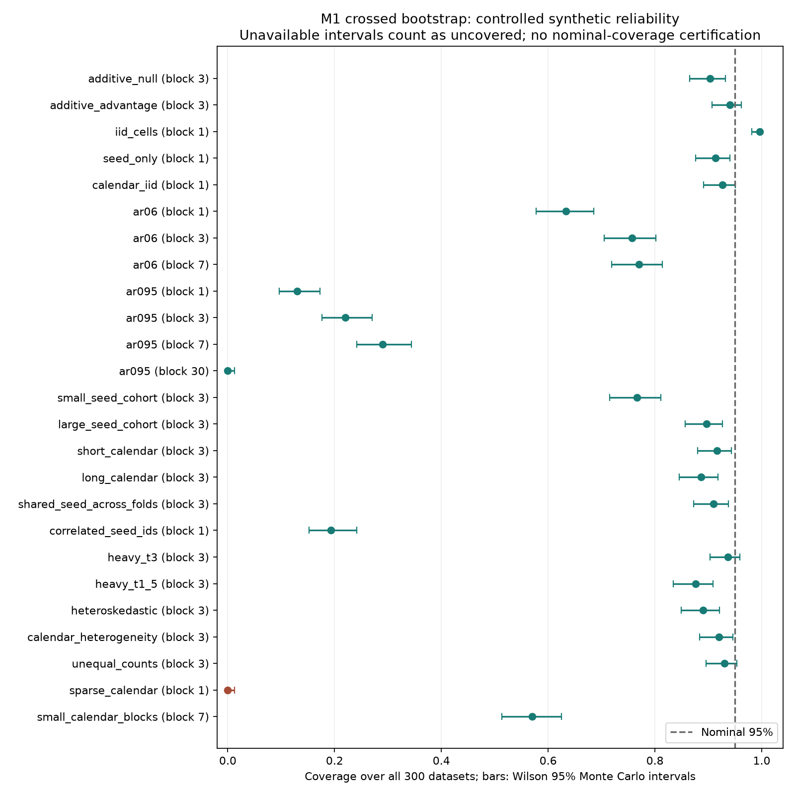

# M2 independent statistical reliability and leakage stress testing

Date: 2026-10-10 (Asia/Kolkata). Branch: `research/v2-m2-statistical-validation`.
Executed implementation: `1f1fb57d8b42adc6adf032bce3adaff8e94fab67`.
Base: `fd7203bf9a2e1e3dd78d9750a948b823ab100d36`.
Final publication adds report/evidence only; consult the branch tip for its SHA.

## 1. Executive summary

**PARTIALLY_READY** for interface integration. The tested arithmetic and observable
contracts are usable with explicit integration gates. **Nominal bootstrap reliability
is not established and fails materially in several controlled settings.** This
milestone completes the independent synthetic investigation; it does not validate
SolarJEPA V2, authorize confirmation, or endorse a preferred model.

OBSERVED: two full, independent process runs produced identical scientific JSON
bytes and payload hashes. Final full suite: **1,338 passed, one pre-existing warning**.
M1's 121 tests remain passing; 46 new M2 tests cover references, calibration,
adversarial catalog, determinism and reproduced regressions. The catalog contains
43 named probes: 6 detected leakage, 27 contract violations, 6 valid boundaries,
and 4 accepted metadata limits.

OBSERVED: nominal 95% crossed intervals covered the additive null truth in 90.3%
of datasets (MC Wilson interval 86.5–93.2%). Strong AR dependence produced 13–29%
coverage at 1/3/7-day blocks; correlated seed IDs produced 19.3%. Pure cell
interaction noise produced conservative 99.7% coverage. These are conditional
findings for the specified synthetic laws, not estimates for real solar losses.

## 2. Research objectives and status language

The objective was to challenge existing M0/M1 evaluation infrastructure with
known truth, difficult distributions, invalid support and numerical extremes.
The [validation plan](V2_M2_VALIDATION_PLAN.md) preceded production implementation;
[configuration](../configs/validation/m2_synthetic.json) fixes this synthetic study.
The task-specific M2 is **not** the older protocol's exposed-data feasibility M2;
that historical plan remains unchanged and unexecuted.

Evidence labels: DOCUMENTED means supported by cited methodology/interface
specification; OBSERVED means direct code/execution evidence; INFERRED means an
interpretation; UNKNOWN means not established. Result statuses:

| Status | M2 assessment |
|---|---|
| VERIFIED | Tested arithmetic, exact support checks, reproducibility, observed simulation rates and rejection/boundary cases |
| PARTIALLY_VERIFIED | Reliability only within tested synthetic laws; integration depends on truthful caller metadata |
| INCONCLUSIVE | Universal/nominal coverage, real-data power, adequate solar block length, practical relevance |
| NOT_TESTED | Real solar loss behavior, selection/training-data variability, operational latency, other platforms, scientific JEPA runs |
| BLOCKED | Confirmatory V2 access/execution and unresolved shared protocol/model-owner decisions |

## 3. Existing M1 functionality reused

Executable inspection confirmed, and current tests exercise:

- P1 immutable forecasting contracts, ordered/unique grids, exact horizons,
  physical-unit/spec alignment and partition-local dependency envelopes.
- P2 normalization fitted on canonical unique raw training support; M1 recomputes
  full statistics and checks declared training/evaluation separation and identities.
- `EvaluationIdentity`/`EvaluationRecord`, strict serialization, actual target/mask
  support fingerprints and complete-record equal-cell dex pinball extraction.
- `LossPanel`/`paired_comparison`: strict paired cohorts/support/metric identity,
  equal fixed-fold origin means, seed/fold/win/influence diagnostics and crossed
  circular calendar-block intervals. No prediction ensembling or fold resampling.
- `calibration_diagnostics`: quantile reliability, pinball, central interval
  coverage, width and proper interval scores, with explicit spaces/units/masks.
- Existing source provenance, normal-installation matching, artifact checksums
  and exclusive atomic publication. No replacement validation framework.

M1 tests established arithmetic/contracts, not confidence interval coverage.
Standalone identity strings are declarations, not authentication of fit history.

## 4. Synthetic design and reproducibility controls

25 configured cases, 300 Monte Carlo datasets/case, 399 bootstrap draws/dataset,
95% NumPy linear percentile intervals, master seed 20261010. This is 7,500
case/dataset evaluations per full run. Block sensitivities share the same data
and analysis stream labels, so they are paired comparisons; repeating the entire
run does **not** double the inferential replication count.

Every random stream comes from a SHA-256-derived label and an explicit NumPy
Generator, with no global RNG. Primary law:

`d[s,f,t] = delta[f] + sigma_seed*Z[s] + sigma_time*X[f,t] + sigma_cell*E[s,f,t]`.

`Z` is shared across fixed folds; `X` is a separate stationary Gaussian AR(1)
path per fold, initialized N(0,1), with innovations `sqrt(1-rho^2)*N(0,1)`.
`E` is independent cell noise. Losses `B=1+abs(d)`, `A=B+d` are nonnegative
without clipping the paired difference. Multiple origins on a day repeat that
same day cell; explicit origin counts determine weights. All units are artificial.
Nonzero generated effects lost to floating-point loss representation are rejected.

The matrix covers null/known effects, seed sensitivity, serial dependence,
unequal support, missingness/sparse days, t3 and t1.5 tails, time-varying variance,
fixed calendar heterogeneity, shared seed effects and correlated seed IDs.
No scientific observation, timestamp, flare class or instrument semantic was
invented or substituted for measured data: these are explicitly artificial laws.

## 5. Ground truth and distinct estimands

The joint truth is the equally weighted mean of fixed-fold `delta[f]`.
Within each fold origins are equally weighted; unequal fold lengths do not change
fold weights. If normalized day counts are `w_f` and AR covariance is `R_f`, the
Gaussian oracle variance is

`V = sigma_seed^2/S + sum_f(sigma_time^2*w_f'R_f*w_f + sigma_cell^2*sum(w_f^2)/S)/F^2`.

Heteroskedastic independent day factors use the .25→2 standard-deviation scale
schedule (variances .0625→4). Correlated seeds use
`Z_s=sqrt(c)*G+sqrt(1-c)*Z_s_independent`, so the seed term becomes
`sigma_seed^2*(c+(1-c)/S)`. The oracle knows this law; it is a positive control,
not an estimator available for real predictions. No naive iid-origin bootstrap
was treated as a valid reference for serial data.

Attribution references distinguish (a) new seeds conditional on the realized
calendar factor, (b) new calendar paths conditional on the supplied latent seed
effects, and (c) joint seed/path expectation within fixed named periods. Cell
innovations are integrated out in these truths. The supplied folds are never
resampled to imply a population of solar periods. Correlation *within* one seed
across folds is supported; correlation *between* seed IDs is a separate deliberate
violation of independent-seed assumptions.

## 6. Bootstrap findings and 7. coverage evidence

Coverage is measured against the stated truth. Unavailable intervals count as
uncovered in the table; conditional available-only rates and every denominator
are also archived in the [aggregate evidence](evidence/v2_m2_synthetic_summary.json).
Bars below are uncertainty of the Monte Carlo rate, not bootstrap intervals.

| Case | Seeds / days per fixed fold | Block days | Coverage % [MC Wilson 95%] | CI excludes 0 % | Mean width | Available % |
|---|---|---:|---|---:|---:|---:|
| additive_null | 10 / 30,30,30 | 3 | 90.3 [86.5, 93.2] | 9.7 | 0.5096 | 100 |
| additive_advantage | 10 / 30,30,30 | 3 | 94.0 [90.7, 96.2] | 82.7 | 0.5142 | 100 |
| iid_cells | 10 / 30 | 1 | 99.7 [98.1, 99.9] | 0.3 | 0.3727 | 100 |
| seed_only | 10 / 30 | 1 | 91.3 [87.6, 94.0] | 8.7 | 1.1259 | 100 |
| calendar_iid | 10 / 30 | 1 | 92.7 [89.1, 95.1] | 7.3 | 0.6890 | 100 |
| ar06 | 10 / 30 | 1 | 63.3 [57.7, 68.6] | 36.7 | 0.6408 | 100 |
| ar06 | 10 / 30 | 3 | 75.7 [70.5, 80.2] | 24.3 | 0.8538 | 100 |
| ar06 | 10 / 30 | 7 | 77.0 [71.9, 81.4] | 23.0 | 0.9053 | 100 |
| ar095 | 10 / 30 | 1 | 13.0 [9.7, 17.3] | 87.0 | 0.3975 | 100 |
| ar095 | 10 / 30 | 3 | 22.0 [17.7, 27.0] | 78.0 | 0.6183 | 100 |
| ar095 | 10 / 30 | 7 | 29.0 [24.2, 34.4] | 71.0 | 0.7584 | 100 |
| ar095 | 10 / 30 | 30 | 0.0 [0.0, 1.3] | 100.0 | 0.0000 | 100 |
| small_seed_cohort | 3 / 30,30,30 | 3 | 76.7 [71.6, 81.1] | 23.3 | 0.7149 | 100 |
| large_seed_cohort | 20 / 30,30,30 | 3 | 89.7 [85.7, 92.6] | 10.3 | 0.4081 | 100 |
| short_calendar | 10 / 12,12,12 | 3 | 91.7 [88.0, 94.3] | 8.3 | 0.5613 | 100 |
| long_calendar | 10 / 90,90,90 | 3 | 88.7 [84.6, 91.8] | 11.3 | 0.4705 | 100 |
| shared_seed_across_folds | 10 / 30,30,30 | 3 | 91.0 [87.2, 93.7] | 9.0 | 1.1346 | 100 |
| correlated_seed_ids | 10 / 30 | 1 | 19.3 [15.3, 24.2] | 80.7 | 0.5127 | 100 |
| heavy_t3 | 10 / 30 | 3 | 93.7 [90.3, 95.9] | 6.3 | 0.5849 | 100 |
| heavy_t1_5 | 10 / 30 | 3 | 87.7 [83.5, 90.9] | 12.3 | 2.5691 | 100 |
| heteroskedastic | 10 / 30 | 3 | 89.0 [85.0, 92.1] | 11.0 | 0.8033 | 100 |
| calendar_heterogeneity | 10 / 12,30,90 | 3 | 92.0 [88.4, 94.6] | 8.0 | 0.5163 | 100 |
| unequal_counts | 10 / 12,30 | 3 | 93.0 [89.5, 95.4] | 7.0 | 0.6689 | 100 |
| sparse_calendar | 10 / 12 | 1 | 0.0 [0.0, 1.3] | 0.0 | unavailable | 0 |
| small_calendar_blocks | 10 / 12 | 7 | 57.0 [51.3, 62.5] | 43.0 | 0.8771 | 100 |



OBSERVED/INFERRED: short blocks under strong persistence miss much of the path
uncertainty. Longer tested blocks improve this case but remain far below nominal.
A whole-period circular block includes every day once: time uncertainty collapses,
width is zero to reporting precision and coverage was 0/300. This is a structural
limitation, not an acceptable general remedy for dependence.

Small seed cohorts undercovered severely (76.7% with three seeds). More seeds or
more calendar days did not establish nominal coverage in this bounded matrix;
do not infer a monotonic ranking from separate finite Monte Carlo samples.
Heteroskedastic coverage was 89.0%. t3 was 93.7%; t1.5 was 87.7% with much wider
intervals. No Gaussian oracle was used for either t law. Sparse calendars gave
0/300 available intervals, correctly preserving the empty-required-draw rule;
this is unavailability, not 300 valid intervals missing truth.

A supplemental fixed-period diagnostic uses the calendar-heterogeneity law,
dataset seed 20261010 and the same explicit 3-day/399-draw settings. True fold
effects are −0.8/0/+0.8; observed fold effects were −0.59324/−0.04838/+0.84321,
while the equally weighted aggregate was +0.06720. Thus the existing fold output
exposes the sign reversal hidden by an aggregate near zero. This is one
descriptive dataset, not inference over a population of periods. Two repetitions
matched exactly; configuration, output/hash and timing are in the aggregate JSON.

Pure independent seed×day cell noise has true mean variance `sigma^2/(S*T)`.
For one-day crossed draws, expected conditional bootstrap variance is larger by
`3-2/S-2/T+1/(S*T)` (2.7367 at S=10,T=30). Independent enumeration of all 108
multinomial row/day draws at S=2,T=3 gave factor 1.5, matching the formula to
1e-14. This explains conservatism for interaction noise; it does not prove
conservatism for all crossed laws. [Owen and Eckles](https://arxiv.org/abs/1106.2125)
discuss related crossed-bootstrap limits; [Politis and White](https://mathweb.ucsd.edu/~politis/SBblock-revER.pdf)
explain the importance of dependence/block choices. Neither certifies M1's hybrid.

## 8. Null direction, CI-exclusion rates and power

Under additive H0 the estimate was negative in 135/300 datasets: 45.0%, MCSE
2.87 percentage points, Wilson interval 39.5–50.7%. Estimated mean difference
0.01054 had MCSE 0.00799. Negative/positive interval exclusions were 15/300 and
14/300. Thus this bounded experiment does not show a directional preference,
but its derived two-sided Type-I rate was 29/300 = 9.67%, MCSE 1.71 points
(Wilson 6.82–13.54%), materially above the nominal 5% target in this law.

For true advantage `delta=-0.4`, estimated mean was -0.39383, bias 0.00617
(MCSE 0.00794). All 300 estimates had the correct negative sign. Negative
CI-exclusion power was 248/300 = 82.67%, MCSE 2.19 points, Wilson 77.98–86.53%.
Coverage of the true effect was 94.0% (90.72–96.17%). These operating characteristics
apply only to this artificial effect/variance/support, not JEPA or prospective V2.

Attribution on additive-null data: seed-only coverage 88.3%, mean width 0.4474;
time-only coverage 90.7%, width 0.2337; joint coverage 90.3%, width 0.5096.
These target different populations and are not interchangeable. In the pure
seed-factor law, time-only width was exactly zero with conditional truth covered
300/300; this correctly conditions away all variability in that constructed law.

M1 outputs intervals and descriptive bootstrap sign fractions, not p-values.
CI exclusion is a derived simulation decision only. All rate MCSEs use
`sqrt(p*(1-p)/R)` with Wilson bounds, including zero-count cases. Small replication
counts cannot certify nominal coverage; 399 draws provide only about ten samples
per 2.5% tail. Cross-case comparisons are exploratory, not a multiplicity-adjusted
test family. A finite simulation mean/SD for t1.5 does not establish finite variance;
bias/width MCSE are unavailable there, while Bernoulli rate MCSE remain valid.

## 9. Adversarial temporal leakage and metadata limits

The complete 43-case catalog with error evidence is in the aggregate JSON.
Representative required cases and valid boundaries:

| Case | Observed outcome | Classification |
|---|---|---|
| overlapping_partitions | rejected | DETECTED LEAKAGE |
| embargo_one_ns_short | rejected | DETECTED LEAKAGE |
| target_crossing_boundary | excluded | DETECTED LEAKAGE |
| future_fitted_normalization | rejected | DETECTED LEAKAGE |
| duplicate_origins | rejected | DETECTED CONTRACT VIOLATION |
| out_of_order_timestamps | rejected | DETECTED CONTRACT VIOLATION |
| dataset_identity | rejected | DETECTED CONTRACT VIOLATION |
| wrong_horizon | rejected | DETECTED CONTRACT VIOLATION |
| invalid_support_metadata | rejected | DETECTED CONTRACT VIOLATION |
| conflicting_normalization_identity | rejected | DETECTED CONTRACT VIOLATION |
| incorrect_fitting_range | rejected | DETECTED LEAKAGE |
| prediction_target_identity | rejected | DETECTED CONTRACT VIOLATION |
| exact_embargo_boundary | accepted | VALID BOUNDARY |
| exact_target_boundary | accepted | VALID BOUNDARY |
| common_missing_run | accepted | UNDETECTABLE FROM AVAILABLE METADATA |
| standalone_failed_fit_label | accepted | UNDETECTABLE FROM AVAILABLE METADATA |
| unknown_evaluation_partition_end | accepted | UNDETECTABLE FROM AVAILABLE METADATA |
| secret_future_feature | accepted | UNDETECTABLE FROM AVAILABLE METADATA |


The builder records explicit exclusions for target/dependency support crossing
its supplied partition; equality at the end and exact embargo are legitimate.
Normalization fitted on future support is rejected even after relabeling its raw
identity when the statistics differ. Mismatched units/quantiles, NaN/Inf losses,
empty panels, invalid shapes, repeated seeds and asymmetric missing runs reject.
A separate direct probe physically removed an origin, its time and loss column
from one model: strict pairing rejected it, rather than comparing a subset.

Four limits are not validator successes at comprehensive prevention: no planned
cohort means a common missing run is invisible; standalone records contain no fit
status evidence; fitting checks receive no original evaluation partition end;
and dishonest future-derived feature arrays can carry internally consistent
false availability/lineage. Caller orchestration must retain builder manifests,
fitting evidence and planned-run identities. Coincidentally equal external
normalization statistics and false provenance cannot be authenticated here.

## 10. Calibration reliability

20,000 artificial origins, two independently sampled normal leads with standard
deviations 1 and 2, one artificial channel and quantiles .05/.25/.5/.75/.95.
Analytic CDF values independently specify reliability. Scores and widths were
recomputed with literal loops and `math.fsum`, without production reduction helpers.

| Quantile forecast | Analytic 90% coverage, lead 1 / 2 | Observed lead 1 / 2 | Width lead 1 / 2 |
|---|---|---|---|
| calibrated | 0.9000 / 0.9000 | 0.9048 / 0.9021 | 3.2897 / 6.5794 |
| underdispersed | 0.5892 / 0.5892 | 0.5907 / 0.5930 | 1.6449 / 3.2897 |
| overdispersed | 0.9990 / 0.9990 | 0.9989 / 0.9991 | 6.5794 / 13.1588 |
| biased | 0.8063 / 0.8063 | 0.8065 / 0.8105 | 3.2897 / 6.5794 |
| tail_only | 0.5892 / 0.5892 | 0.5907 / 0.5930 | 1.6449 / 3.2897 |
| horizon_failure | 0.9000 / 0.4709 | 0.9048 / 0.4761 | 3.2897 / 3.2897 |


All main-run quantile reliability cells were within 2.661 binomial SE of their
analytic probabilities (the prespecified descriptive check allowed five SE).
Maximum scaled score/width/reliability arithmetic discrepancy was 2.946e-13;
maximum absolute discrepancy was 3.876e-12 over large constant-width reductions.
Literal small fixtures retain 1e-12 absolute checks; large reductions use
`error/max(1,abs(reference)) <= 1e-12`. This is floating-point roundoff evidence,
not a change to expected scientific values.

The tail-only forecast leaves inner quantiles intact but reduces 90% coverage to
about 59%; lead-specific failure leaves lead 1 calibrated while lead 2 covers
47.6%. Crossing is rejected by `ForecastPrediction` before scoring. Coverage alone
must be read with width and proper interval score; overdispersion almost always
covers while giving excessively wide intervals. Proper scores follow
[Gneiting and Raftery](https://sites.stat.washington.edu/raftery/Research/PDF/Gneiting2007jasa.pdf).

Rare-regime construction is pre-issue artificial R~Bernoulli(.1), U|R=rare uniform
(.9,1), otherwise uniform (0,.9); the mixture is exactly uniform. With unchanged
marginal quantiles, observed overall 90% coverage was **0.899325**, common coverage
**0.943304** (truth .85/.9), and rare coverage **0.499748** (truth .5; 1,983 rare
origins). This is systematic conditional failure despite correct marginal
calibration, not merely finite-sample noise. It establishes no solar regime label,
formal simultaneous calibration inference, trajectory or event probability.

## 11. Numerical and contract robustness

Observed cases include empty panels (reject), empty/masked diagnostic support
(null), one origin (point estimate permitted, bootstrap availability explicit),
one seed (joint API rejects), small cohorts, constant differences/zero variance,
nonfinite/overflow arithmetic, incompatible units/quantiles, duplicate/reordered
identities, missing/failed declared fitting identities and noncontiguous days.
No hidden sample deletion, broadcasting or forecast fabrication was observed in
these probes. Those observations apply only to tested boundaries.

Direct-origin bootstrap reference matched M1 across three nonconstant fixtures
with two folds, unequal counts, empty days and truncated blocks: maximum interval
endpoint discrepancy **1.110223e-16**, against 1e-12 tolerances. Full-int64-span
arithmetic is separately tested. Memory checks safely intercept oversized
allocations; no actual 17 GB allocation was attempted. Default total dense
calendar budget is one million seed×day cells (about 24 MB for three float64
sum arrays, plus input/draw buffers), configurable explicitly. It changes no
support or statistical setting and is not a total-process RSS guarantee.

## 12. Reproduced defects and fixes

All rows below had failing regressions before correction. Existing expected
values and protected scientific/model code were preserved.

| Area | Reproduction | Correction |
|---|---|---|
| M1 paired effect | B=1e16, A−B=(2,0,2,0): effect 0 and CI [0,0], truth 1 | Reduce paired differences directly, including bootstrap; relative effect uses −difference/reference |
| M1 seed dispersion | Seeds have effects 1e−300 and 2e−300: SD reported 0 | Scale before SD, restore units; true SD 0.7071e−300 |
| M1 memory | Sparse valid calendar/cohort requested 17.08 GB dense array | Configurable total calendar-cell guard before allocation |
| M2 null reporting | Cancelling fixed effects: 100% coverage and 100% null exclusion from −2.8e−17 | Consistent 1e−12 coverage/null-exclusion convention |
| M2 infinite variance | t1.5 finite empirical SD incorrectly emitted bias MCSE | Mark finite-variance status; suppress bias/width MCSE |
| M2 reference timestamps | int64 subtraction wrapped valid late origins, CI .5 instead of 1.5 | Python integer subtraction before conversion |
| M2 mutable design | Progress callback changed later replications/effect after validation | Detached canonical configuration snapshot |
| M2 tiny effect | Deterministic 1e−20 difference rounded away in baseline loss | Reject lost nonzero generated effects |
| M2 final provenance | Execution-package drift could publish using initial attestation | Rerun complete final code provenance and Git/source identity, reuse final attestation |

Malformed scenario configurations also now raise consistent ValueError.
These corrections improve arithmetic and reproducibility; they do not repair
finite-sample/bootstrap assumptions or silently replace the inference procedure.
No unresolved reproduced HIGH/BLOCKER implementation defect remains in the
reviewed scope after final regressions. Methodological risks remain below.

Independent statistical and fresh software reviewers inspected code and executed
synthetic probes. Their original findings are retained in this table; reviewers
did not author fixes. Statistical review checked oracle/conditional estimands;
software review safely reproduced allocation, timestamp, configuration,
representation and provenance defects. Final fixes were verified through
coordinator RED→GREEN tests and the full suite. A bounded independent follow-up
confirmed the final provenance fix and passed 17 relevant
reproducibility/execution-package tests; no remaining actionable defect was found.

## 13. Reproducibility evidence

Executed source fingerprint:
`7847120aa2667c087477acf28c8a1b3e6dbb402669ad642b94254e014545ac71`.
Effective configuration fingerprint:
`12b8da68a4cf702e5d6e57c8618591fa5dddb7106e67174972484b44b5727bf5`.
Both full-run canonical scientific payload hashes:
`0c4ee722a0c287774c277928342fe548648dee81e5cb137ed3238297d3d53a1e`.
Both serialized `scientific.json` file hashes (includes terminal newline):
`efa930fbbcc373893b7b890dec7a932dcd43fb789cf40fdd5b825de45dae58cd`.
Timing/UUID metadata intentionally differs. No old output directory was overwritten.

Portable local outputs are `results/experiments/m2-29837ffaf989-61d9466ffa07`
and `results/experiments/m2-29837ffaf989-e8d14b256dda`. They remain ignored;
small aggregate evidence, configuration, report and figure are tracked. Every
artifact byte count/SHA was verified with `verify_artifacts`. The JSON aggregate
archives complete case settings, Monte Carlo denominators/uncertainty, calibration,
contract evidence, source/config/environment identities and both artifact manifests.
The supplemental calendar diagnostic is reproducible with
`Scenario(name='calendar_heterogeneity', days=(12,30,90), delta=(-.8,0.,.8))`,
`generate_panels(scenario, 20261010)` and `paired_comparison` using block_days=3,
replicates=399, rng_seed=20261010, confidence=.95. Remaining parameters are the
archived explicit defaults. Its output hash is
`0da2e70599fdfa170293ef1eba69500a9e2570ae1aa535e79e06eb6b4c71d952`.

Environment: Python 3.13.3, NumPy 2.2.6, pytest 9.1.1, scipy 1.18.1;
macOS 26.3 arm64. No new dependency. Scipy is recorded from the existing
environment but the new statistical utilities use NumPy/standard library only.
Normal installed imports from `/tmp` under `python -I` passed; no Torch loaded.
`pip check` reported no broken requirements. Repeatability is demonstrated on
this platform/version combination, not guaranteed bitwise across platforms.

Reproduce with the recorded source/config and dependency versions:

```bash
.venv/bin/python -m pip install --no-deps --no-build-isolation .
.venv/bin/python scripts/run_m2_validation.py --pilot
.venv/bin/python scripts/run_m2_validation.py
.venv/bin/python -m pytest -q tests/test_m2_*.py tests/test_independent_*.py
.venv/bin/python -m pytest -q
```

The CLI defaults to its repository root, accepts explicit `--root`, requires clean
tracked source/normal installed parity, publishes unique directories and checks
Git/checkout/execution-package identity again before publication. No dataset file
is discovered. Git/source/execution-package drift, incomplete budget execution
and artifact replacement reject. The effective configuration is detached,
fingerprinted and embedded; external configuration files are not monitored for
later changes after that snapshot.

## 14. Computational cost and executed tests

| Check | Observed outcome |
|---|---|
| M1 baseline suite launched before M2 source edits | 1,292 passed, one warning, 209.50 s |
| Final targeted M1/M2 suite | 167 passed, 10.09 s |
| Final full suite after all corrections/reinstall | 1,338 passed, one warning, 196.10 s |
| Independent final provenance/reproducibility follow-up | 17 relevant tests passed |
| Final-source pilot | 25×5 datasets×99 draws; 1.362 s |
| Full run 1 / repeat | 271.499 s / 269.627 s; identical scientific bytes |
| Peak process RSS | 129,449,984 / 129,122,304 bytes (about 123 MiB) |
| Full artifact size | About 101 KB per run plus small manifest; no raw arrays |
| Independent paired bootstrap reference | Three fixtures×101 draws, max error 1.11e−16 |
| Import/package/whitespace/storage checks | PASS; details in final publication verification |

Each full study uses 2,992,500 M1 joint draws, 718,200 attribution reference draws,
and 402 fixed reference/robustness draws, below the planned four-million budget.
The supplemental period diagnostic adds two runs of 399 draws, taking
0.083/0.040 s; it does not change any Monte Carlo replication denominator.
The two main runs and tests overlapped: runtimes are process wall times, not an
isolated performance benchmark. Two earlier main attempts were interrupted for
review corrections before publication; their incomplete results were not used.
Three distinct small pilot artifacts from implementation checkpoints are retained.
The earlier pilot payload changed when fixes changed outputs; final-source full
runs are the scientific evidence. Interrupted-attempt total time was not archived.

The warning is the existing `test_adapter_preserves_selected_quality_mask_and_unknown_actual_availability`
NumPy ndarray-size binary-compatibility warning, not suppressed or fixed here.
Its numerical impact remains UNKNOWN. Historical counts were not reused as
current evidence. Unit tests, references, adversarial cases, calibration,
determinism, regression and installed package checks all actually ran.

## 15. Statistical limitations

Synthetic correctness is not real solar validation. Representative independent
training seeds, adequate weakly dependent approximately stationary blocks,
truthful dependency/provenance, fixed-fold interpretation and complete planned
run support are assumptions. Nonstationary activity, shared training-data/search
variability, small seed samples and unknown operational availability remain risks.
Circular wrapping is artificial. Finite B/R add Monte Carlo error; no B→infinity
or large-sample coverage study was performed. Heteroskedastic and heavy-tailed
results describe these particular laws, not every such distribution.

The known Gaussian oracle is theoretically exact for its law; its observed
finite-MC coverage varied across cases. Do not use individual Monte Carlo bands
as simultaneous certification across 25 exploratory settings. Standard errors of
bias/width rely on finite-variance conditions; for t1.5 those outputs are unavailable.
Empirical finite SD/RMSE are descriptive, not population uncertainty estimates.
Formal calibration inference, joint trajectories, real flare strata, event warnings,
period-population inference, real-data dependence checks and cross-platform
reproduction were NOT_TESTED. No favorable block length or seed was selected.

## 16. Integration recommendations

1. Reuse canonical records and strict loss extraction, but require window-builder
   partition manifests, recomputed fitting evidence and a planned cohort/fit-status
   ledger in the caller. Paired agreement alone cannot reveal common omissions.
2. Expose CI assumptions and availability; do not label current percentile outputs
   as reliable nominal 95% evidence by default. Treat seed/fold influence summaries
   as descriptive. Seed-sensitive fixture effect −0.2667, win fraction 1/3,
   leave-one-seed effects +0.2/−0.5/−0.5 correctly expose instability.
3. Coordinate a separately authorized methodological/interface milestone: decide
   the estimand, planned-run evidence and model-owner adapters, then evaluate
   finite-sample alternatives/approved dependence diagnostics. Preserve all failed
   regimes; do not amend settings to seek favorable JEPA outcomes.
4. Candidate calendars, access attestations, custodian, operational causality,
   multiplicity, selection/failure policies and physical/SoLEXS gates remain open.
   No shared decision was frozen by this synthetic configuration.

## 17. Readiness gate, access record and publication boundaries

| Criterion | Assessment |
|---|---|
| M1 regression tests preserved | VERIFIED |
| Null/known-effect recovery and seed sensitivity investigated | VERIFIED, with undercoverage and power limits reported |
| Coverage measured with Monte Carlo uncertainty | VERIFIED measurement; nominal reliability PARTIALLY_VERIFIED/INCONCLUSIVE outside specific laws |
| Temporal adversarial/boundary testing | VERIFIED within supplied metadata, with four explicit limits |
| Calibration arithmetic and conditional failure | VERIFIED on known laws |
| Repeatability/provenance/no replacement | VERIFIED on this host |
| Remaining assumptions and integration dependencies | Documented; unresolved |
| Scientific JEPA retraining / confirmatory access / V2 model experiments | None |
| Shared protocol change / protected files / PR / merge | None |

**Verdict: PARTIALLY_READY.** Arithmetic and observable-contract integration can
proceed only with the documented caller evidence and qualified uncertainty.
Nominal confirmatory inference remains blocked pending approved methodology and
scientific access gates. This verdict authorizes no next milestone automatically.

No raw/processed solar product, candidate holdout or ignored V1 result was opened.
No scientific JEPA retraining or V2 model experiment ran. Full regression suites
do execute existing tiny synthetic neural/JEPA training fixtures in temporary
directories; those are software checks, explicitly distinguished from research
retraining. No acquisition or shared protocol decision changed. Only the M2 branch
was edited/published; main, v1, M1, presentation and teammate branches were not
modified. Original untracked work remains in the original checkout.

Final publication verification: all 19 changed paths are confined to M2 code,
tests, configuration and documentation plus the minimal comparison fixes above.
Protected training/forecasting/experiment/data/V1 paths have an empty diff.
The index contains only the four final report/evidence/figure files; each is
under 162 KB. Earlier milestone commits contain no raw data, bulk arrays or
generated result directories. Actual full-run outputs, cache and environment
paths match existing ignore rules. Tracked raw/interim/processed/results
directories contain only their four existing `.gitkeep` files. Both artifact
manifests and the aggregate's copied results were reverified; supplemental
fold/seed reduction orders agree within 5.56e−17. Whitespace/index/scope/history
checks pass. The original presentation checkout still has precisely its prior
untracked `.agents/` and `docs/P1_FINAL_INTEGRATION_REAUDIT.md`; its tracked state
and branch are preserved. Final commit and remote synchronization are reported
at publication, without changing any protected branch.
