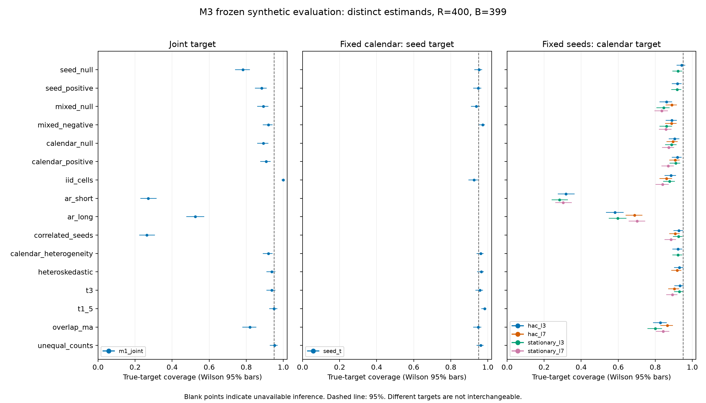

# M3.1 statistical inference research, benchmarking and conditional remediation

Date: 2026-10-11 (Asia/Kolkata). Branch: `research/v2-m3-inference-remediation`.
Base M2: `94cae59398e52a65074ec66c73ad94bd47ca8867`.
Frozen executable evaluation: `f0806e37ff1993ab7735776adde12ac08df719cd`.
Publication adds evidence, this report and a plotting-only roundoff correction.

## 1. Executive summary

**Verdict: NO_VALIDATED_REPLACEMENT.** No candidate passed every eligible frozen
screen. No M1 default, shared protocol, model, runner owned by a teammate, V1
configuration or previous artifact was changed. All new inference paths remain
experimental. This research does not validate real solar forecasting or authorize
confirmatory experiments.

**VERIFIED:** M2's complete synthetic scientific payload was reproduced before
implementation. Three conditional method families were implemented and assessed
on the same 16 predeclared evaluation laws, 400 datasets per law and 399 bootstrap
draws per dataset. Two final executions produced identical scientific bytes/hash.
The final suite passed 1,391 tests, including 53 new M3 tests, with one pre-existing
NumPy binary-compatibility warning. No research JEPA training or sealed data access
occurred; existing full-suite tiny synthetic training fixtures were exercised.

Seed-t passed 8/9 eligible Gaussian screens. Its iid-cell failure is retained;
finite Monte Carlo variability and the all-case screen prevent interpreting that
one failure as a refutation of the exact Gaussian theorem. Fixed short temporal
settings failed substantially under persistent losses. Arbitrary common training
seed shocks remain unidentified from one cohort. Conditional success would not
supply joint seed-and-calendar inference.

## 2. Evidence audit and M2 failure mechanisms

**OBSERVED:** local and remote M2 matched the full base SHA; the reported checkpoint
was verified after fetching. M3 was created from origin/M2 in a separate managed
worktree and published before edits. The original presentation checkout and its
untracked work were preserved. M0/M1/M2 documents, protocol proposals, executable
code, tests, saved JSON and history were inspected. Documentation was supporting
evidence; executable behavior determined these conclusions.

Replayed all 25 M2 scenarios, R=300, B=399, at the base commit: runtime 235.886 s,
scientific SHA-256
`0c4ee722a0c287774c277928342fe548648dee81e5cb137ed3238297d3d53a1e`, matching
M2 evidence. Reproduced headline rates: additive-null coverage 90.3%, Type-I 9.67%,
known-advantage power 82.67%, strong-AR coverage 13–29%, correlated-seed coverage
19.3%, iid-cell coverage 99.7%. Baseline suite: 1,338 passed, one warning, 218.06 s.
The preserved local replay is `results/experiments/m2-29837ffaf989-ad9fa641c832`.

The exact producer is `evaluation/comparison.py:paired_comparison`, used by
`evaluation/stress/study.py`. One seed-resampling vector is shared across fixed
folds; separate circular day-block draws within each fold are shared across paired
models/seeds. Equal fold weighting and observed origin counts are retained. Empty
required draws invalidate the interval; NumPy linear percentiles form it.
Bootstrap sign fractions are descriptive, not null-calibrated p-values. Existing
paired records, contracts, generators, rate summaries and source/atomic-artifact
provenance were reused unchanged.

| Mechanism | Evidence and interpretation |
|---|---|
| Finite seed count / percentile construction | New S=4 null M1 coverage 78.25%; Gaussian seed-t 95.25%. Resampling a small empirical seed cohort does not supply an exact Gaussian t interval. |
| Too-short time blocks and finite record length | Short/long AR cases strongly undercovered; exact known-law effective-information calculations below explain why record length alone is misleading. |
| Common seed shock | A cohort-wide shock vanishes after seed centering. No independent seed labels or larger B identify its between-cohort variance. |
| Crossed interaction noise | M1 iid-cell coverage was 100% in the new evaluation. For an illustrative iid row×column bootstrap, the interaction variance factor tends to three; M1's circular blocks are not exactly that finite-sample law. |
| Estimand mismatch | Calendar-conditional and seed-conditional truths differ from joint truth. Their zero-exclusion rates cannot generally be called Type-I error or power. |
| Implementation defect | No new M1 resampling arithmetic defect was reproduced. M2's previous numerical fixes were already in the base. |

The iid illustration follows directly from independent multinomial row/column
weights: variance factor `(2−1/S)(2−1/T)−1 → 3` relative to the iid cell-mean
variance. It diagnoses interaction inflation, rather than proving a universal
factor for the actual circular-block method. Crossed-resampling conservatism is
also discussed by [Owen–Eckles](https://arxiv.org/abs/1106.2125).

## 3. Statistical estimands and independent units

Let d[s,f,o]=loss_A−loss_B, r_s=mean_f(mean_o d[s,f,o]), and theta_hat=mean_s r_s.
Positive effects mean higher loss for A. All folds retain equal weight regardless
of length. Multiple horizons/channels/quantiles are paired support, not independent
replications. A forecast origin, calendar day, named period and training run are
different units. Reusing a seed number is not evidence of independent runs.

| Target | Conditioning and random unit | Supported question |
|---|---|---|
| seed_conditional | Fixed realized calendar, training data and selection recipe; new independent paired runs | Expected loss effect across training seeds on that calendar |
| calendar_conditional | Supplied latent seed effects fixed; new within-fold paths; independent fixed fold paths | Expected within-period calendar effect for those seeds |
| joint | New seeds and new within-fold paths for the same named periods | M1 comparator only; no replacement implemented |
| Future period/dataset population | Independent selection of periods/datasets | Not identified by a few purposively chosen folds |

For the additive synthetic law, seed truth is delta_bar plus the realized weighted
calendar factor; calendar truth is delta_bar plus the realized seed factor. Cell
noise is integrated out in both. These latent effects are known in simulation,
not observable or certified in real data. Coverage averages over generated
conditioning realizations; it is not a uniform conditional coverage guarantee.
The proposed V2 design does not establish arbitrary across-seed independence or
representative future-period sampling. **UNKNOWN:** real loss dependence, seed-score
law, effective independent clusters and training/search uncertainty.

## 4. Literature review and candidate screening

Primary sources were used at the access depth stated here. No research tool or
new dependency was installed. Brief literature claims are separated from our own
finite-law derivations and observed simulations.

| Candidate | Assumptions / units / restrictions / cost | Disposition |
|---|---|---|
| Moving block bootstrap | Approximately stationary weak dependence, contiguous overlapping blocks, growing block length and enough blocks; O(BT), boundary weighting matters | Researched |
| Circular block bootstrap | Circular contiguous time blocks, same dependence conditions, artificial wrap; crossed M1 also resamples seeds, O(BSTF) | Existing comparator preserved |
| Stationary bootstrap | Geometric-length circular runs; stationary finite-variance weak dependence and suitable block sequence, O(BT) | Implemented, fixed ell=3/7 diagnostic settings |
| Nested / hierarchical bootstrap | Legitimately nested independent sampling units; cannot substitute nesting for a seed×calendar cross | Not implemented |
| Two-way clustered covariance | Independent clusters in both dimensions, many informative clusters, intersection correction; time grouping must handle serial dependence | Researched; few clusters/common shocks unresolved |
| Bartlett HAC / DM-style mean test | Paired daily mean scores, stable mean, finite moments and weak dependence, suitable bandwidth; O(TL), normal approximation | Implemented calendar-conditional HAC L=3/7; no official DM procedure |
| Studentized block intervals | Valid variance estimator inside each draw and enough information; O(BTL), zero/small studentizers problematic | Researched |
| Cluster wild bootstrap | Independent informative clusters and justified restricted-null construction; O(BN); few-cluster discreteness/imbalance remain | Researched |
| Seed Student t | Independent common-mean Gaussian run scores; exact df=S−1. Independent common-location normal scale mixtures give conservative confidence≥95%, with a finite mean required for our target; O(SN) | Implemented |
| Joint additive variance | Independent additive seed/time factors; interaction must be corrected, serial HAC has no justified T−1 chi-square law | Not implemented without defensible theory |

Sources: [Newey–West working-paper abstract](https://www.nber.org/papers/t0055)
(full PDF inaccessible); [Politis–Romano publisher abstract](https://www.tandfonline.com/doi/abs/10.1080/01621459.1994.10476870)
and [Stanford technical-report record](https://statistics.stanford.edu/technical-reports/stationary-bootstrap);
[Cameron–Gelbach–Miller author manuscript](https://cameron.econ.ucdavis.edu/research/JBESpaper2009version.pdf)
(two-way covariance sum minus intersection);
[Cameron–Miller survey](https://cameron.econ.ucdavis.edu/research/Cameron_Miller_JHR_2015.pdf)
(few clusters and bootstrap restrictions);
[Diebold–Mariano original scan](https://www.ssc.wisc.edu/~bhansen/718/DieboldMariano1995.pdf)
(limited machine-readable access; not an implemented reference);
[Ibragimov–Müller full §2.1](https://www.princeton.edu/~umueller/tstat.pdf)
(normal scale-mixture location theorem);
[corrected block-length methodology](https://public.econ.duke.edu/~ap172/Patton_Politis_White_2009.pdf).
A universal minimum cluster count or an h−1 dependence cutoff is not assumed.

## 5. Implemented methods and restrictions

All paths are isolated in `evaluation/inference_research/`; none is a production
default. Typed `Design`, `MethodConfig`, `RunState` and `InferenceResult` require
estimand, sampling unit, confidence, RNG seed, law/dependence/moment declarations,
planned ordered seed cohort, complete successful run ledger and missing-run policy.

Seed-t uses per-seed equal-fold scores and sample SD/sqrt(S), t_(S−1) critical
values. Gaussian scores assert common-mean iid sampling. Normal scale-mixture
support asserts independent symmetric common-location scores and confidence≥.95;
finite mean is explicit, so Cauchy means are unsupported. The t1.5 law here has a
mean despite infinite variance. No arbitrary skewed heavy-tail guarantee follows.

HAC averages fixed seed losses by day, centers within each fixed fold, uses
Bartlett weights and an explicit T/(T−1) variance correction; independent fold
variance estimates combine with 1/F² and normal critical values. Stationary basic
intervals reflect linear bootstrap quantiles about theta_hat. Uniform starting
days, geometric restarts and circular continuation are shared across paired models
and fixed seeds. Separate fold streams preserve the declared fold independence.
The block variants use fixed per-step uniforms/fresh indices for RNG coupling.

Calendar methods require complete equal positive origin counts per day within a
fold; unequal fold lengths are supported. HAC permits declared heteroskedastic weak
dependence; stationary inference rejects it. Necessary guards T≥max(8,4(L+1)) or
T≥max(8,4ell) do not prove independent blocks. Dense calendar and bootstrap-index
arrays are capped at one million cells. Copies/processing scale with supplied
loss support; configured DGPs are additionally bounded.

Nonfinite/malformed contracts raise ValueError; unsupported assumptions and
insufficient information return unavailable intervals with reasons. No dropping,
interpolation, numerical fallback or point CI is used. Metadata declarations
cannot authenticate their own truth.

## 6. Benchmark design and anti-overfitting controls

The research plan and both presets were committed at `e797d8a` before candidate
code or final results. Original M2 laws were never edited. Development uses 13 M2
laws, R100/B199, master20261011; pilot only R5/B99. Final evaluation uses 16 separately
predeclared cases, R400/B399, master20261117. Configuration bytes remain unchanged
from the first commit. No candidate setting, acceptance threshold, seed or DGP was
changed after final results; no fresh favorable selection run was conducted.

Every method sees identical panels in a dataset, with case/replicate/stage SHA-derived
streams. Common random numbers couple stationary block settings. M1 block=3 is the
joint comparator; conditional candidates are seed_t, HAC L3/L7 and stationary ell3/ell7.
The new overlap law is a normalized sum of five independent Gaussian innovations,
with covariance max(0,1−k/5) through lag4. It is separate from unchanged M2 laws.
An independent 1,200-path review probe matched that covariance, with maximum
conditional-truth discrepancy 2.22e−16; it did not run frozen evaluation or inspect
its results.

Metrics retain R in unconditional coverage/failure denominators, also reporting
available-only coverage. All rate fields include counts, binomial MCSE and Wilson95.
Type-I is zero exclusion only for a true fixed zero target; power is directional
exclusion only for a fixed signed alternative. Mixed conditional cases report
zero exclusion separately. Bias, empirical RMSE, width, runtime and failure reasons
are recorded; variance-based MCSE is omitted for t1.5. Paired coverage-comparison
MCSE is reported only within the same estimand. Repeated execution adds no new R.

## 7. Frozen coverage results

Each entry is percent coverage of its own true target; unavailable is `—`, never
interpreted as an achieved 0% coverage. Every available row had 400/400 intervals;
unsupported rows had 0/400. Complete counts, MCSE, Wilson intervals, widths, bias,
RMSE, reasons and within-target paired comparisons are in
[the aggregate evidence](evidence/v2_m3_inference_summary.json).

| Frozen case | M1 joint | Seed t | HAC3 | HAC7 | Stationary3 | Stationary7 |
|---|---:|---:|---:|---:|---:|---:|
| seed_null | 78.25 | 95.25 | 94.25 | — | 92.25 | — |
| seed_positive | 88.25 | 94.75 | 92.00 | — | 91.75 | — |
| mixed_null | 89.25 | 93.75 | 86.00 | 89.00 | 84.50 | 83.50 |
| mixed_negative | 92.00 | 97.25 | 89.00 | 88.75 | 86.00 | 85.75 |
| calendar_null | 89.25 | — | 90.50 | 89.50 | 88.75 | 87.25 |
| calendar_positive | 90.75 | — | 92.00 | 90.75 | 91.00 | 87.00 |
| iid_cells | 100.00 | 92.50 | 88.50 | 86.00 | 87.75 | 84.00 |
| ar_short | 27.00 | — | 31.75 | — | 28.25 | 30.25 |
| ar_long | 52.50 | — | 58.25 | 68.75 | 59.75 | 70.25 |
| correlated_seeds | 26.25 | — | 92.75 | 90.75 | 92.50 | 88.50 |
| calendar_heterogeneity | 92.00 | 96.25 | 92.25 | — | 92.25 | — |
| heteroskedastic | 93.75 | 96.50 | 93.00 | 91.75 | — | — |
| t3 | 93.75 | 95.75 | 93.25 | 90.25 | 93.00 | 89.25 |
| t1_5 | 95.00 | 98.25 | — | — | — | — |
| overlap_ma | 82.00 | 94.75 | 82.75 | 86.50 | 80.00 | 84.25 |
| unequal_counts | 95.25 | 96.25 | — | — | — | — |




## 8. Monte Carlo uncertainty and Type-I error

| Case / method / target | Coverage % [Wilson95] | Type-I % [Wilson95] | Coverage MCSE (pp) |
|---|---:|---:|---:|
| seed_null / m1_joint / joint | 78.25 [73.95, 82.01] | 21.75 [17.99, 26.05] | 2.06 |
| seed_null / seed_t / seed_conditional | 95.25 [92.70, 96.94] | 4.75 [3.06, 7.30] | 1.06 |
| iid_cells / seed_t / seed_conditional | 92.50 [89.50, 94.70] | 7.50 [5.30, 10.50] | 1.32 |
| calendar_null / hac_l3 / calendar_conditional | 90.50 [87.23, 93.00] | 9.50 [7.00, 12.77] | 1.47 |
| calendar_null / stationary_l7 / calendar_conditional | 87.25 [83.62, 90.17] | 12.75 [9.83, 16.38] | 1.67 |
| ar_short / hac_l3 / calendar_conditional | 31.75 [27.38, 36.47] | 68.25 [63.53, 72.62] | 2.33 |
| ar_long / stationary_l7 / calendar_conditional | 70.25 [65.59, 74.52] | 29.75 [25.48, 34.41] | 2.29 |
| correlated_seeds / m1_joint / joint | 26.25 [22.18, 30.77] | 73.75 [69.23, 77.82] | 2.20 |


These are pointwise Wilson intervals, not simultaneous bounds or posterior
probabilities. For rates of zero/one, plug-in MCSE is zero but the Wilson interval
still expresses finite Monte Carlo uncertainty. Strong persistence failures are
much larger than their MCSE. At iid cells seed-t coverage370/400 and Type-I30/400
fail the unchanged gate: coverage lower=.89495 and Type-I upper=.10505.

Under the exact Gaussian theorem, P[Binomial(400,.95)≤370]=.01903. The gate accepts
coverage counts372–392 in a genuine null case. An exact95% method has per-case
screen-failure probability .03133, and approximately .249 probability of at least
one failure over nine independent exact cases. The failed gate is retained; it
neither establishes an implementation defect nor overturns the theorem. No
criterion is relaxed or rerun selected on this result.

## 9. Statistical power observations

| Fixed alternative / method / target | Directional power % [Wilson95] | MCSE (pp) |
|---|---:|---:|
| seed_positive / m1_joint / joint | 38.50 [33.86, 43.36] | 2.43 |
| seed_positive / seed_t / seed_conditional | 21.25 [17.52, 25.52] | 2.05 |
| calendar_positive / m1_joint / joint | 65.00 [60.20, 69.51] | 2.38 |
| calendar_positive / hac_l3 / calendar_conditional | 60.75 [55.88, 65.41] | 2.44 |
| calendar_positive / hac_l7 / calendar_conditional | 61.75 [56.90, 66.38] | 2.43 |
| calendar_positive / stationary_l3 / calendar_conditional | 64.00 [59.18, 68.55] | 2.40 |
| calendar_positive / stationary_l7 / calendar_conditional | 65.75 [60.97, 70.23] | 2.37 |


The positive alternatives have delta=.35, so A has higher expected loss. M1's
apparently higher power accompanies poor null coverage and cannot establish a
calibrated advantage. For the S8 Gaussian seed case, independent noncentral-t
calculation gives positive-direction rejection probability .23115, within the
observed seed-t Wilson interval. Calculation: score variance=.7²+.2²(1/24+1/36)/4;
noncentrality=.35 sqrt(8/variance); evaluate t7's upper critical value using the
noncentral-t survival function. This is a separate analytical diagnostic, not
selection tuning. The mixed-negative seed-t zero-exclusion rate68% is not power.

## 10. Interval width, bias and failure behavior

| Case | M1 joint | Seed t | HAC3 | HAC7 | Stationary3 | Stationary7 |
|---|---:|---:|---:|---:|---:|---:|
| seed_null | 1.0435 | 1.9921 | 0.0476 | — | 0.0454 | — |
| calendar_null | 0.5603 | — | 0.5852 | 0.5883 | 0.5577 | 0.5440 |
| iid_cells | 0.1879 | 0.1274 | 0.1095 | 0.1035 | 0.1058 | 0.0965 |
| ar_short | 0.5037 | — | 0.5911 | — | 0.5322 | 0.5598 |
| ar_long | 0.3853 | — | 0.4430 | 0.5784 | 0.4598 | 0.6149 |
| correlated_seeds | 0.4417 | — | 0.0558 | 0.0530 | 0.0538 | 0.0489 |


Widths use artificial loss units and available intervals. They cannot be ranked
across different conditional targets as if they measured the same uncertainty.
Bias/RMSE for every row and finite-variance MCSE are preserved in JSON; empirical
heavy-tail moments without a variance are descriptive and have no claimed stable
MCSE. Calendar methods reject unequal/missing daily counts and infinite variance;
stationary methods reject heteroskedastic nonstationarity. Seed-t rejects correlated
seeds and no-score-variation cases. The broader development sparse-support case
made M1 unavailable through empty required bootstrap folds, preserving its contract.

## 11. Dependence sensitivity and effective information

For a unit-marginal stationary AR(1), the known-DGP mean effective day count is
T²/[T+2 sum_(k=1)^(T−1)(T−k)rho^k]. It is 1.303 for T28/rho.97 and 13.151 for
T240/rho.9. This is a component-specific analytical diagnostic, not a solar
estimate or the complete estimator's effective sample size. Independent fixed
fold paths remain an assumption; a calendar gap does not prove independence.

At rho.9, true long-run variance is19. Fixed HAC L3/L7 converge to fractions
.1855/.32555 of it; geometric stationary ell3/ell7 target approximately
.21053/.40789. Growing record length with those fixed settings does not restore
general validity. Longer blocks/lags can increase variance and reduce usable
replications; they cannot be tuned here after observing final results. Forecast
horizon overlap adds dependence but need not exhaust its length. In the MA overlap
case, all calendar candidates undercovered (80–86.5%) while seed-t targets a different
conditional parameter and covered94.75%.

For S equicorrelated seed factors with correlation c, the component variance is
sigma_seed²[c+(1−c)/S]. Its independent-run equivalent is S/[1+(S−1)c]: 1.488 for
S16/c.65. M1 jointly covered26.25%; seed-t correctly rejected the dependence.
Calendar-conditional coverage does not solve this uncertainty because realized
seed effects are fixed in that target. One cohort cannot estimate arbitrary
unseen common shocks: **INSUFFICIENT INDEPENDENT INFORMATION**.

Calendar effects −.6,.1,.9 on fixed lengths24,48,96 are explicitly averaged by fold,
not day. The covered fixed-fold average does not establish stable period-specific
effects or representatively sampled future calendars. Conditional heteroskedastic
HAC L3 covered93%; that single screen pass is not a general guarantee. Infinite-
variance t1.5 calendar paths are unsupported. Seed-t's98.25% there is conservative
symmetric-mixture evidence, outside the exact-Gaussian gate and arbitrary-tail claims.

## 12. Numerical and contract reference validation

**VERIFIED:** literal df2 t critical value via independent analytic CDF inversion;
HAC variance via Toeplitz quadratic form, including independent unequal-fold
scaling review; stationary variance by enumeration of all27 Markov paths, maximum
error5.55e−17; 100,000 bootstrap paths match exact small-path variance within
predeclared1.5% sampling tolerance; reflection rather than percentile intervals;
large-offset paired subtraction; exact constant/no-variation rejection; explicit
finite-mean contract; deterministic RNG; planned seed-cohort omissions and fit
failures; support/unit/metric mismatches; missing daily counts; guards and invalid
configuration. No expected simulation value or tolerance was changed to pass.

All15 deterministic run-failure probes reject: five candidates each challenged
with one-model omission, common omission from both models, and a failed fitting
record. These are contract rejection rates on three fixed adversarial fixtures,
not a Monte Carlo sampling design for random failures. M1's panel-only API cannot
authenticate a planned cohort omitted from both models; the new explicit ledger is
experimental caller evidence, not proof against dishonest metadata. Temporal
leakage/calibration M1/M2 regressions remain passing; M3 does not claim expanded
causality detection or new calibration methods.

## 13. Computational cost

| Execution | Datasets × draws | Runtime (s) | Peak RSS (MiB, macOS) |
|---|---:|---:|---:|
| development | 13×100×199 | 11.940 | 157.9 |
| evaluation | 16×400×399 | 115.361 | 158.0 |
| pilot | 13×5×99 | 1.313 | 157.8 |
| repeat | 16×400×399 | 112.407 | 159.7 |


Nominal whole-bootstrap-replicate budgets: development776,100; each final7,660,800,
below8million/900s; unsupported methods skip computation. These counts are not
per-fold index draws. Final peak process RSS was about158MiB, below the1GiB planning
cap; this is OS peak RSS, not a per-method memory profile. The figure shows each
target separately. No bulk synthetic arrays are committed.

## 14. Reproducibility evidence

Frozen final scientific hash (both distinct executions):
`4eae0b13e366d243718c0342552c5a51062851652261f52f2e47c9b6b8f69055`.
The aggregate JSON records both artifact IDs, source/config fingerprints, full
executed SHA, Python/platform/dependency versions, time/RSS, tolerances and all
scientific rows. Final code/config/metadata checks were clean and source identities
were rechecked before atomic publication. Installed project execution was captured
and matched checkout source; inference did not load torch. Paths in evidence are
repository-relative. UUID suffixes prevent output collisions; files are immutable.

Python3.13.3; NumPy2.2.6; SciPy1.18.1; pytest9.1.1; Matplotlib3.11.2;
macOS26.3 arm64. Relevant baseline package versions are also recorded. Numerical
reference atol/rtol1e−12; truth-coverage tolerance1e−12 max(1,abs(truth)); zero-exclusion
threshold±1e−12. Explicit Generator objects and SHA-derived streams avoid global RNG.
Same-platform scientific bytes repeat; cross-version/architecture bitwise equality
is **NOT_TESTED**. Timing/RSS are outside the scientific hash.

Reproduce at the frozen executable commit with the existing locked environment:

```sh
python -m pip install --no-deps --no-build-isolation .
python scripts/run_m3_inference.py --pilot
python scripts/run_m3_inference.py --config configs/validation/m3_development.json
python scripts/run_m3_inference.py --config configs/validation/m3_evaluation.json
python scripts/run_m3_inference.py --config configs/validation/m3_evaluation.json
python -m pytest -q
```

Use the two distinct emitted evaluation IDs and development/pilot IDs with
`python scripts/summarize_m3_inference.py --evaluation ID1 --repeat ID2 --development
DEV --pilot PILOT`. The publication exporter includes a plotting-only correction
for a Wilson endpoint rounding to1−eps at observed rate1. Scientific bounds are
preserved unchanged. This presentation fix followed evaluation; no candidate,
statistical kernel, benchmark, preset or scientific payload was revised afterward.

## 15. Reproduced defects and fixes

| Finding | Reproduction / resolution | Impact |
|---|---|---|
| Identical nonbinary seed means acquired roundoff variance | RED regression produced a tiny point interval; exact no-variation guard | Candidate defect fixed before simulations |
| Nonzero CI collapsed on rescaling | Subnormal1e−323 and near1e16 RED cases; result-level unavailable reason | Candidate numerical defect fixed before simulations |
| Scale-mixture location confused with expected mean | Independent theory review; explicit finite_mean and undefined-mean rejection | Candidate contract fixed before final evaluation |
| Integer Boolean declaration / tiny nonzero null label | RED regressions; strict Boolean validation and exact-null classification | Out-of-preset defects fixed before final; configurations unchanged |
| Unattested external driver copy | Review probe passed checkout hashing with different executed driver bytes; move scientific runner into captured package | Reproducibility fix before final; old development artifacts not retroactively strengthened |
| Same execution accepted as repeat | RED regression; distinct resolved directories and execution time identities | Export validation fixed before final |
| Plot error at observed coverage1 | Actual export failed on negative1e−16 error-bar length; clip plotting length only | Post-evaluation presentation-only fix; raw evidence unchanged |

The initial df2 tabulation in a test was inaccurate. Independent60-digit Decimal
CDF inversion gave4.30265272974946385…, agreeing with SciPy within2e−15; the literal
was corrected before simulations without changing tolerance. No M1 production
inference fix was justified or applied. No failing test was weakened.

## 16. Independent review and testing

Independent read-only statistical, benchmark/Monte Carlo and software reviewers
challenged estimands, mixture means, fixed bandwidths, source capture, common inputs,
RNG coupling, missing runs and result attribution. Reproduced issues were resolved
before final evaluation except the presentation-only figure-length rounding fix.
Review of all96 final rows found correct Type-I/power attribution, and no new
method implementation defect. Statistical and software review conclusions were
independently checked by execution and diffs.

53 new M3 tests passed. Full suite at frozen evaluation source:1,391 passed,
one existing warning,93.17s; final publication check is recorded below. Normal
installed import, CLI help, pip check, exact artifact checks, deterministic repeat,
figure render and `git diff --check` passed. The warning says NumPy ndarray C-header
size16 differs from runtime96 in an existing NetCDF-related fixture; its numerical
impact remains **UNKNOWN** and it was not suppressed or fixed out of scope.

Publication verification after the plotting correction: **1,391 passed, one
existing warning, 92.43 s**. Re-exporting into the existing evidence paths matched
their bytes and performed no overwrite of different evidence. Final and repeated
scientific files were compared byte for byte and matched.

## 17. Method-selection decision

Gate: eligible designs fixed before results; availability100%; pointwise coverage
Wilson95 lower≥.90 and upper≤.99; genuine-null Type-I Wilson95 upper≤.10; numerical,
contract and reproducibility checks pass. Power is not a selection criterion.
Conservative mixture cases are not forced into exact-Gaussian coverage criteria.

| Candidate | Eligible cases | Passed | Failed | Decision |
|---|---:|---:|---:|---|
| hac_l3 | 14 | 3 | 11 | FAILED_SCREEN |
| hac_l7 | 10 | 0 | 10 | FAILED_SCREEN |
| seed_t | 9 | 8 | 1 | FAILED_SCREEN |
| stationary_l3 | 13 | 1 | 12 | FAILED_SCREEN |
| stationary_l7 | 10 | 0 | 10 | FAILED_SCREEN |


**FAILED:** every method has at least one eligible frozen screen failure. **INCONCLUSIVE:**
seed-t iid failure as evidence against its Gaussian theorem, given Monte Carlo
uncertainty/multiple screens. **VERIFIED:** strong fixed-setting temporal undercoverage,
unsupported correlated-seed declarations, numerical references and reproducibility.
**PARTIALLY_VERIFIED:** restricted conditional methods are implemented and independently
checked but not accepted as an all-screen replacement. **NOT_TESTED:** real solar
assumptions, other bandwidth selectors/studentizers, future-period inference and
cross-platform bitwise reproducibility.

Readiness verdict: **NO_VALIDATED_REPLACEMENT**. No optional M1 integration was added.
The research milestone is complete with a negative selection outcome. The production
comparator remains available for traceability, without being endorsed for confirmatory
claims under the failed designs.

## 18. Remaining scientific limitations

Small independent seed cohorts, persistent short records and unidentified common
shocks cannot be repaired by computation alone. Actual run independence, fitting
recipe, training-data/search randomness, real calendar stationarity, skewness and
support missingness need evidence. Fixed folds do not identify a population of new
periods. Nominal uncertainty cannot be claimed from bounded pointwise screens.
HAC L7 had no eligible development case and was first assessed in final evaluation;
no setting was tuned on that assessment. B399 gives finite bootstrap-quantile noise,
not an exact resampling law. Gate multiplicity can reject a correct method, and
conditional averaging can conceal particular hard conditioning realizations.
No causal validator can prove honest supplied provenance. No real loss or scientific
holdout was inspected; real-data applicability remains unverified.

## 19. Proposed M1 integration contract

**REQUIRES_PROTOCOL_APPROVAL:** first choose the scientific target and design its
independent runs/calendars. Any later optional adapter must name its estimand,
conditioning set, sample/weight units, moments/dependence law, planned per-model
run ledger, block/lag configuration, confidence, RNG seed and unavailable behavior.
It must retain paired metric/horizon/channel/quantile support, equal-fold weighting
when agreed, strict missing-run rejection and existing provenance. Results must
never present conditional CIs as joint CIs or bootstrap sign fractions as p-values.
Keep the old method explicitly selectable; change no default without approval.
This proposal neither selects an official method nor freezes M0 decisions.

## 20. Next-stage recommendations and scope confirmation

A separately authorized design/methodology milestone should establish independent
seed cohorts and the intended conditioning target, then predeclare suitable temporal
bandwidth/block rules or a defensible joint-factor correction with fresh synthetic
assessment. Investigate small-sample inference and overlap without tuning to this
final benchmark. Seed-t remains a theory-supported restricted research candidate;
its frozen screen failure cannot be removed by relabeling or favorable reruns.

No JEPA research retraining, sealed holdout access, V2 confirmatory evaluation,
shared protocol change, protected-branch merge/push, teammate edit or PR occurred.
No M3.2 work was started. Git publication is confined to the M3 branch. Only small
aggregate synthetic evidence/figure, reusable research code, tests and docs are
tracked. Original M2 evidence and all previous checkpoints remain preserved.
